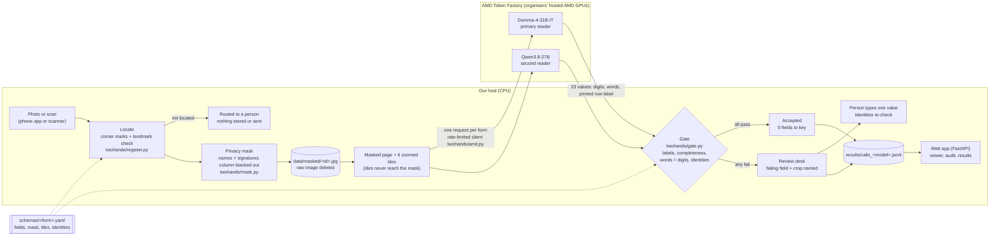

# Architecture

One idea: **the model reads, the paper decides.** The vision model is a reader, not a judge. Acceptance is a
deterministic function of what the model read and the identities printed into the form.

## Diagram



## Components

| Component | File | What it does |
|---|---|---|
| Form type | `schemas/mx_presidencia_2024.yaml` | Canonical page size, corner markers, privacy mask rectangles, tiles, the 23 ordered fields with the printed label expected at each position, and the 4 identities. A new form type is a new file like this one. |
| Sampler | `twohands/sample.py` | Draws the pre-registered stratified sample (state x capture type, seed 20261015) from the official CSV. |
| Locator | `twohands/register.py`, `twohands/landmarks.py` | Finds the page by its four corner markers (or a SIFT + RANSAC match when markers are cut off), fixes orientation, refines with ECC, and accepts a warp only if 8 printed landmarks land within 1% of page width. Otherwise raises `NotLocated`. |
| Privacy mask | `twohands/mask.py` | Fills the names-and-signatures column black, saves the 2400x1552 masked page, deletes the raw download, and cuts tiles that stay left of the mask. |
| Reader | `twohands/reader.py` | Builds the prompt from the schema (its sha256 is frozen in `PROTOCOL.md`), sends one request per form, parses the first complete JSON object. |
| AMD client | `twohands/amd.py`, `twohands/ratelimit.py` | OpenAI-compatible client for AMD Token Factory. A file-based limiter paces request starts across processes (6/min by default, 2 in flight per process), honours 429 Retry-After, backs off on 5xx, and checks `/usage` against a daily budget. The key is read from the environment and never logged. |
| Gate | `twohands/gate.py` | Shape, row label, completeness, words = digits, identities. Returns accepted or routed with reasons and failing fields. 100% deterministic. |
| Runner | `twohands/run.py` | Resumable batch: prepare (download, locate, mask) then Gemma over all forms, then Qwen. One stable record per form in `results/calls_<model>.jsonl`. |
| Web app | `app/`, `templates/`, `static/` | Form viewer, review desk, audit gallery of keying errors, results page, live read on AMD (one at a time, budget-guarded, streamed as server-sent events). |
| Numbers | `app/store.py`, `app/numbers.py` | Every measured number on the site is computed at request time from the result files. Cited context numbers are constants with their source. List: `docs/NUMBERS.md`. |
| Second form type | `ledger/` | Snapshot of the rainfall-ledger reads and their per-year checksum (12 months = written annual total). |

## The gate in one screen

For the tally sheet the identities are, verbatim from the schema:

```yaml
identities:
  - {name: "rows sum to TOTAL", sum: "@vote", equals: [TOTAL]}
  - {name: "votaron + representantes = section 5", sum: [VOTARON, REPRESENTANTES], equals: [PERSONAS_Y_REP]}
  - {name: "section 5 = section 7", sum: [PERSONAS_Y_REP], equals: [SACADOS]}
  - {name: "section 7 = TOTAL", sum: [SACADOS], equals: [TOTAL]}
```

Before the identities run, each value must come back with the printed label beside it, and code compares that
label with the schema position. A row label that fits a neighbouring row better than its own is evidence of a
skipped, doubled or shifted row, and routes the form. This check exists because of a failure we measured on the
rainfall ledgers (see `docs/EVALUATION.md`, failure case).

## Design choices

- **One request per form.** Page plus tiles in one call. No agent chain, no tool calls. Fewer moving parts and a
  fixed cost per form.
- **Fail closed everywhere.** Page not located, call failed, reply not parseable, `finish_reason == "length"`:
  each one routes the form to a person. None is retried silently into an accept.
- **Privacy before the model.** Only masked pages and tiles cut from them are stored, sent or served. The app's
  image routes refuse any file outside `data/masked/` and every crop box stops left of the mask
  (`tests/test_mask.py`, `tests/test_app_routes.py`).
- **Neutral by construction.** The app labels vote rows "Option 01" to "Option 15" and never serves party names
  (`tests/test_app_neutral.py`).
- **Numbers from files.** The headline switches to the largest graded run with at least 100 forms as soon as its
  results file exists. No number is typed into a template.
