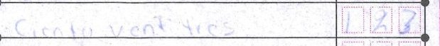
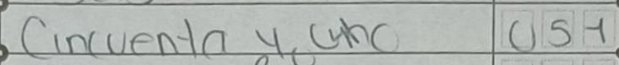

# Gemma on AMD

Two Hands' reader is **Gemma-4-31B-IT**, served on AMD GPUs by AMD Token Factory (the organisers' hosted endpoint,
[AMD.md](AMD.md)). Every one of the 289 measured reads of the pre-registered 300-form run is Gemma on AMD. This page
is the engineering behind that: what the model has to do, the one limit we had to work around, how the reply is
made safe to accept, what it costs, and how it compares with Qwen3.8-27B on the same forms.

<!-- why-gemma:start -->
Same 300 forms, same gate, on AMD: Gemma accepts 1.8x the forms Qwen3.8-27B does at the same error rate, 4.6x cheaper and 2.8x faster, with no truncated answers. Every zero-error two-reader pair includes Gemma; the only pair without it made errors (2 of 814).

| Reader | Forms accepted | Wrong of accepted fields | $ per 1,000 forms | Mean time per read |
|---|---|---|---|---|
| **Gemma-4-31B-IT** | **55 of 300 (18%)** | 2 of 1,210 | $0.14 | 87 s |
| Qwen3.8-27B | 31 of 300 (10%) | 1 of 682 (+2 undecided) | $0.64 | 241 s |
| Qwen3.8-Flash-Next | 17 of 128 (13%) | 0 of 374 (+1 undecided) | $2.11 | 120 s |
| Gemma-4-31B-IT + Qwen3.8-27B | 89 of 300 (30%) | **0 of 1,958** | $0.78 | – |
| Gemma-4-31B-IT + Qwen3.8-Flash-Next | 42 of 128 (33%) | **0 of 924** | $2.25 | – |
| Qwen3.8-27B + Qwen3.8-Flash-Next | 37 of 128 (29%) | 2 of 814 (+1 undecided) | $2.75 | – |

*Pairs: all 23 digits agree, lighter gate (secondary). Qwen3.8-Flash-Next: first 128 forms (budget rule). Source: app/data/bakeoff_300.json.*
<!-- why-gemma:end -->

## Misreads the arithmetic caught

Two of Gemma's misreads on the 300, where it read the digits and the words the same wrong way, so only the form's own
sums could catch them. In both, the failed sum was the only reason the gate refused the form, and the paper's value
balances it. Crops are cut from the masked page, right of the logo column (`app/why_gemma.py`, `scripts/why_gemma.py`).

<!-- caught:start -->

Form 122655C0100, Option 02: Gemma read 23 in the digits and 23 in the words; the paper says 123 (the official capture keyed 123, the certified count says 123). The gate refused the form: rows sum to TOTAL, 366 ≠ 466; with the paper's 123 it is 466 = 466.

Form 110922C0100, Option 04: Gemma read 54 in the digits and 54 in the words; the paper says 51 (the official capture keyed 51, the certified count says 51). The gate refused the form: rows sum to TOTAL, 329 ≠ 326; with the paper's 51 it is 326 = 326.
<!-- caught:end -->

## 1. A job only a vision-language model can do

A Mexican polling-station tally sheet (INE 2024, Presidencia) carries 23 quantities. Each is written **twice by
hand**: in digit boxes ("Con numero") and as the amount **in Spanish words** ("Con letra": *doscientos treinta y
cuatro*). The scans are phone photos (Movil) and flatbed scans (Escaner); some are in faint pencil.

Gemma reads, in one request per form:

- the handwritten **digits** of all 23 values,
- the handwritten **Spanish words** of all 23, read independently of the digits and converted to an integer,
- the **printed label** of each row (a section title, or the party logos at the left of a vote row).

Classic OCR does not turn handwritten Spanish number words into integers, and it does not tell which party logos are printed on a row; a vision-language model does both in the same pass as the digits. On the
289 forms read in the 300 run, Gemma returned both digits and words for 5,935 fields, and they agreed on 5,818
(98.0%) (`app/data/gemma_vs_qwen.json`, `gemma_full_300.words_equal_digits`). Where they disagree, the form goes to a
person: that disagreement is the signal, not noise.

What it found: **52 fields where the official two-person capture does not match the paper**, 27 of them readable
fields the capture recorded as illegible, **23 of those on two faint pencil forms** that Gemma read and the paper
confirms ([EVALUATION.md](EVALUATION.md); `app/data/headline.json`, `faint`). The certified count covers 21 of the
faint-form fields and agrees with the paper on 18.

## 2. The engineering

### 2.1 The fixed image budget, and tiling around it

**The endpoint's limit.** On this endpoint Gemma gets a **fixed budget of about 263 tokens per image, whatever its resolution**.
Measured on every read of the 300 run: 7 images per request, `usage.prompt_tokens_details.image_tokens` = **1,843**
on all 289 reads (`results/calls_gemma.jsonl`), so 263 per image. Upscaling does not help: in the ledger spike a 2x
upscale got the same prompt tokens and no gain (75.2% vs 74.6% cell accuracy on 8 sheets,
[sources/ledger-rescue-pilot.md](sources/ledger-rescue-pilot.md) "Why tiling matters"). Qwen3.8-27B's image budget grows with the pixels: about
1,800 tokens per image on the pilot images ([sources/tally-witness-pilot.md](sources/tally-witness-pilot.md) section 3) and 5,817 for the same 7
images here (831 per image).

The AMD Token Factory serves Gemma at a fixed image budget, so every number here uses that budget. Gemma 4 itself
supports 70 to 1,120 soft tokens per image, set per request; on a self-hosted AMD GPU the tiles could be replaced by
one high-budget image.

**The workaround: spend more images, not more pixels.** Each request carries the masked page plus zoomed tiles cut
from it (`schemas/mx_presidencia_2024.yaml`, `layout.tiles`; `twohands/mask.py`; `twohands/reader.build_body`):

| Image | Region of the 2400 x 1552 page | Share of page area | Token density vs the page |
|---|---|---|---|
| 1 | whole masked page (keeps rows aligned) | 100% | 1x |
| 2 | left column, sections 2-5 | 20% | ~5x |
| 3 | 7 single-party rows | 12% | ~8.5x |
| 4 | 8 coalition rows | 12% | ~8x |
| 5 | NO REGISTRADAS, NULOS, TOTAL, section 7 | 12% | ~8.5x |
| 6 | party logo cells, enlarged | 1.4% | ~70x |
| 7 | coalition logo cells, enlarged | 1.5% | ~65x |

Tiles overlap and the prompt says so; image 1 is there so the model keeps every row in line. Tiles are cut from the
already masked page and never reach into the privacy mask (`tests/test_mask.py`).

**Measured before and after** (all Gemma on AMD Token Factory):

| Evidence | Before | After |
|---|---|---|
| Rainfall ledgers, 40 sheets ([sources/ledger-rescue-pilot.md](sources/ledger-rescue-pilot.md) section 3) | single image: **79.2%** cells exact, 17.6% of year-columns pass the checksum, 0% of sheets | page + 3 strips: **96.8%** cells exact, 80.5% of columns pass, and 3,976 of 3,976 accepted cells right |
| Tally sheets, 43-form pilot ([sources/tally-witness-pilot.md](sources/tally-witness-pilot.md) section 3) | page + 3 tiles: 92.4% fields exact, 17/43 accepted | page + 4 tiles + targeted prompt: **96.5%** fields exact, 21/43 accepted, 462/462 accepted fields right |

Single-image Gemma on the ledgers also produced the one error an arithmetic check cannot catch, a silent column
shift where every shifted column still balances (26 wrong cells accepted); tiling removed it (same README, section
4). The pilot's v1 errors were coalition rows shifted by one and faint "0 0 0" boxes returned as null; v2 tiles and
the prompt fixed most of both. For the pre-registered run two enlarged logo tiles were added (images 6-7) because the
row-label check below needs legible logos (`PROTOCOL.md` section 8). Cost of the extra images:
about $0.00002 per form (pilot $0.00012 vs $0.00010 for one tile fewer).

### 2.2 A frozen prompt

The prompt is generated from the schema (`twohands/reader.build_prompt`) and frozen before the run:
**sha256 `3664253035b912184e24a205852e7b8e686f0abb36a4340e91834d60dc71193f`** (`reader.prompt_sha256()`,
pinned in `PROTOCOL.md` section 4). Every row of `results/calls_gemma.jsonl` and `results/calls_qwen.jsonl` carries
it, and `scripts/gemma_vs_qwen.py` checks it on every row compared. The prompt asks for digits and words
independently ("if they disagree, report both as written"), says a faint "0 0 0" is 0 and not null, and asks for a
`"fix": true` marker on crossed-out values. Temperature 0. No `response_format`: images plus JSON mode broke Gemma
on this endpoint, so the JSON is parsed from text.

### 2.3 The row-label check

The section 6 rows are **not named** in the prompt. Gemma must report the label it sees at each position: the
section title, or the party logos printed on that row joined with "+". The gate (`twohands/gate.py`, check 2)
compares it with the schema's expectation at that position. Text rows (section titles, NULOS, TOTAL) must match their
keywords; a logo row fails when its label is empty or fits a neighbouring row better than its own. That turns a
skipped or doubled row, which would otherwise shift every value below it and still look plausible, into a visible
"row label mismatch". Its price, measured on the 300: it routed 86 forms, and on 68 of them the read was in fact
right; 15 were routed by the label check alone, all 15 read right (`app/data/headline.json`, `label_gate`). Gate v2
(post-hoc, labelled so) relaxes it; the headline uses the frozen gate.

### 2.4 `finish_reason`, `max_tokens` and junk after the answer

A warning on the hackathon Discord: Gemma on this endpoint can keep generating after a complete answer
(degenerate tails). Three defences, all in the frozen protocol (`PROTOCOL.md` sections 2.3 and 4):

1. **The parser takes the first complete JSON object** holding a `values` list and ignores anything after it, plus
   code fences, `<think>` blocks and leading zeros (`"n": 003`) (`twohands/reader.parse`).
2. **`max_tokens` 2000** for Gemma: about 2.4x the longest answer measured, so a runaway tail is cut short and cheap.
3. **`finish_reason == "length"` is never accepted**, whatever the parser recovers (`twohands/run.py`): a truncated
   reply routes the form to a person.

Measured on the 300 run: **289 of 289 Gemma reads finished with `stop`**, completion tokens 804 mean and 841 at
most, no trailing text after the JSON on any read, no parse failure. The same defences matter more for Qwen: 37 of
its 250 replies so far hit its 6,000-token cap (`length`) and were routed, never accepted
(`results/gemma_vs_qwen.md`).

### 2.5 Latency, tokens and cost per form (measured)

From `results/calls_gemma.jsonl`, last read per form, 289 reads of the pre-registered run:

| | Gemma-4-31B-IT on AMD |
|---|---|
| Server time per form | **83 s** mean (HTTP round trip of the answered request; 87 s wall clock with our limiter; `results/amd_benchmark.md`) |
| Tokens in / out | 2,609 (1,843 of them image) / 804 |
| Cost per form | **$0.000144**, so $0.14 per 1,000 forms |
| Total Gemma spend, 300 run incl. retries | $0.042 |

## 3. Gemma vs Qwen on the same forms

Qwen3.8-27B read the same 300 forms after Gemma (pre-registered order), with the same masked page + 6 tiles, the
same frozen prompt and the same frozen gate (`reasoning_effort: "low"`, `max_tokens` 6000). The numbers below are
regenerated from the calls files by `python scripts/gemma_vs_qwen.py` (also run by `make eval`), which writes
`results/gemma_vs_qwen.md` and `app/data/gemma_vs_qwen.json`; the overview page reads the latter. The Qwen pass is
complete: the comparison is on **all 300 forms** (289 located pages sent to both; 11 never sent).

| On the same 300 forms | Gemma-4-31B-IT | Qwen3.8-27B |
|---|---|---|
| Usable reads (of 289 sent) | **289** | 239 (50 cut at `max_tokens`) |
| Touchless (frozen gate accepted) | **55** (18.3%) | 31 (10.3%) |
| Accepted fields wrong, vs the paper | 2 of 1,210 | 1 of 682 (2 more undecided on the paper) |
| Replies cut at `max_tokens` | 0 | 50 |
| Mean time per form (wall clock, incl. our limiter) | 87 s | 241 s |
| Tokens in / out | 2,609 / 804 | 6,612 / 3,340 |
| Cost per form read | **$0.000144** | $0.000597 |
| **Two readers, strict mode (Amendment 2 d, secondary; lighter gate): both agree on all 23 digits** | **89 forms, 0 of 1,958 accepted fields wrong** (full gate, section 7: 22 forms, 0 of 484) | |

**Gemma accepts about 1.8 times as many forms with no person, at about a quarter of Qwen's cost per form**, with
the same order of error on what it accepts. Both models' wrong accepted fields are unused ballots, the one graded
field that sits in no arithmetic identity, so no single-reader gate can check it; Gemma's two are 010469C0400 (read
239 in both digits and words, paper 234) and 212668C0300, Qwen's is 090955C0200. **Together they are stricter than
either alone:** the two readers agree on all 23 digits on 147 forms, and the strict two-reader tier (agreement, words
and the row sum; no label check) accepts 89 forms with 0 of 1,958 accepted fields wrong; the 3 accepted fields where
the agreed read differs from the official capture are all capture errors (`results/two_reader_300.md`).
<!-- same-model:start -->Two Gemma reads as the two readers: 5 wrong of 2,816 accepted fields, against 0 of 1,958 with Qwen as the second reader. Same-model reads share mistakes, which is why the second reader is a different model.<!-- same-model:end --> (`results/gemma_b4_300.json`, Amendment 8.)

Caveats, stated as measured: the two passes ran at different times on a shared endpoint (Gemma 01:38-11:49 UTC,
Qwen from 11:53 UTC on 2026-10-15), so latency reflects endpoint load as much as the model; the adjudication was done
on Gemma's disagreements with the capture, but every accepted Qwen field that differs from the capture turned out to
have a verdict already (none is left unadjudicated); in the 43-form pilot, where Qwen was not truncated, it was the
slightly more accurate reader (97.4% vs 96.5% fields exact) at 4.3x the cost ([sources/tally-witness-pilot.md](sources/tally-witness-pilot.md)
section 3).

## 4. Provenance of every Gemma number

**Every measured read of the 300-form run (289 forms read; 11 pages could not be located and were never sent) is
Gemma on AMD GPUs**, and so is the 100-form confirmation; no stored Gemma number was produced by another model. Live
reads use Gemma when the endpoint lists it and fall back to Qwen3.8-27B otherwise, with Qwen's own frozen parameters
and a banner (`app/livemodel.py`); every receipt names its reader. The endpoint log: [AMD.md](AMD.md).
