# Adjudication sheet (Amendment 2 b)

Every field where the reader disagrees with the PREP capture. Crops are cut from masked pages only.
Verdict: one of model_right, capture_right, paper_ambiguous, unreadable. Edit `adjudication.jsonl` (`verdict`, `note`).

| clave | field | model digits / words | PREP | Computos | form | verdict | crop |
|---|---|---|---|---|---|---|---|
| 070282C0200 | PVEM_PT | 8 / 7 | 7 | 7 | routed |  | 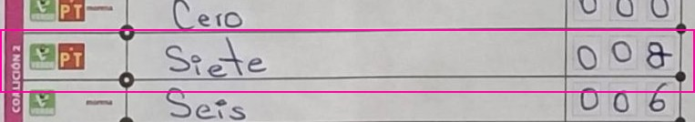 |
| 080305B0100 | PRI | 15 / None | Ilegible | 15 | routed |  | 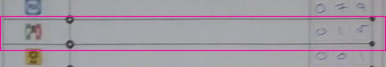 |
| 080310B0100 | SOBRANTES | 180 / 180 | 480 | - | accepted |  | 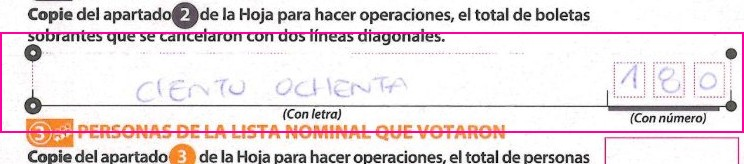 |
| 080336B0100 | SACADOS | None / None | 193 | - | routed |  | 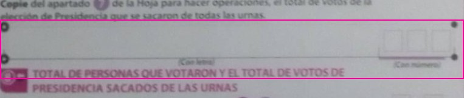 |
| 080338C0100 | MORENA | 143 / 93 | 93 | 93 | routed |  | 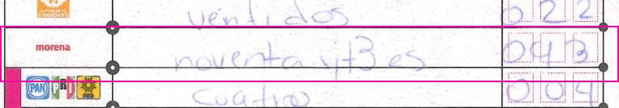 |
| 080338C0100 | SOBRANTES | 321 / 381 | 381 | - | routed |  | 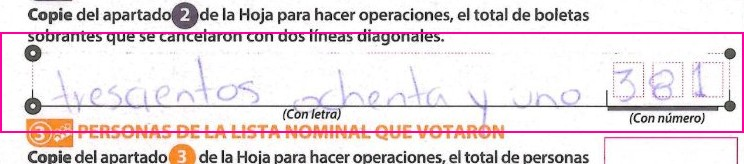 |
| 083281B0100 | NO_REGISTRADAS | None / 1 | 1 | 1 | routed |  | 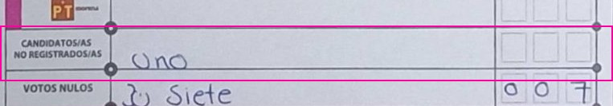 |
| 090955C0200 | REPRESENTANTES | 100 / None | 0 | - | routed |  | 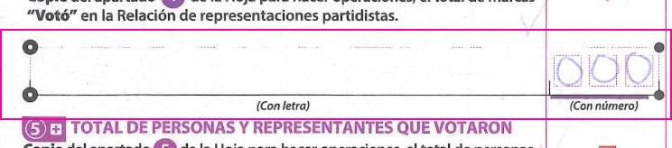 |
| 090955C0200 | SOBRANTES | 200 / None | 206 | - | routed |  | 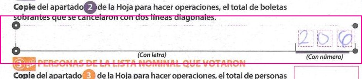 |
| 092366B0100 | SOBRANTES | 497 / 497 | 197 | - | routed |  | 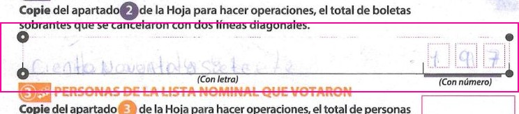 |
| 093478C0100 | PRI | 629 / 29 | 29 | 29 | routed |  |  |
| 093831B0100 | MC | 39 / 39 | Ilegible | 39 | routed |  | 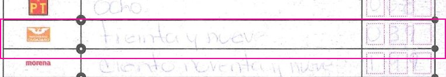 |
| 093831B0100 | MORENA | 199 / 199 | Ilegible | 198 | routed |  |  |
| 093831B0100 | NO_REGISTRADAS | 0 / 0 | Ilegible | 0 | routed |  | 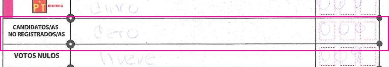 |
| 093831B0100 | NULOS | 9 / 9 | Ilegible | 10 | routed |  | 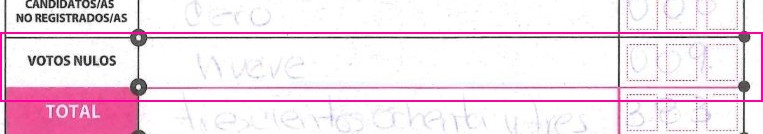 |
| 093831B0100 | PAN_PRD | 0 / 0 | Ilegible | 0 | routed |  |  |
| 093831B0100 | PAN_PRI | 1 / 1 | Ilegible | 1 | routed |  |  |
| 093831B0100 | PAN_PRI_PRD | 7 / 7 | Ilegible | 7 | routed |  |  |
| 093831B0100 | PRD | 7 / 7 | Ilegible | 7 | routed |  |  |
| 093831B0100 | PRI_PRD | 0 / 0 | Ilegible | 0 | routed |  |  |
| 093831B0100 | PT | 8 / 8 | Ilegible | 8 | routed |  |  |
| 093831B0100 | PT_MORENA | 5 / 5 | Ilegible | 5 | routed |  | 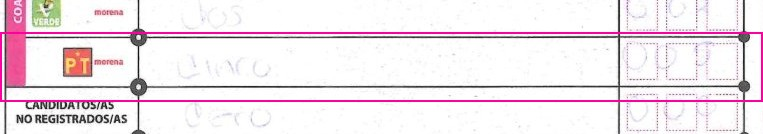 |
| 093831B0100 | PVEM | 11 / 11 | Ilegible | 11 | routed |  | 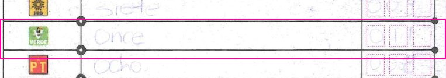 |
| 093831B0100 | PVEM_MORENA | 2 / 2 | Ilegible | 2 | routed |  | 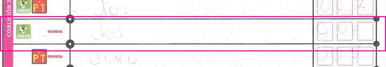 |
| 093831B0100 | PVEM_PT | 2 / 2 | Ilegible | 2 | routed |  | 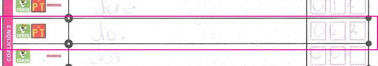 |
| 093831B0100 | PVEM_PT_MORENA | 1 / 1 | Ilegible | 12 | routed |  | 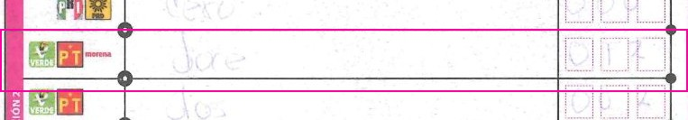 |
| 093831B0100 | SACADOS | 388 / 388 | Ilegible | - | routed |  | 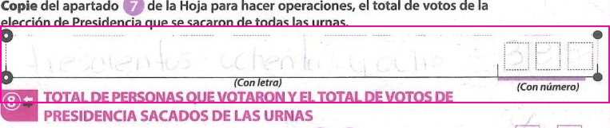 |
| 093831B0100 | TOTAL | 383 / 383 | Ilegible | - | routed |  |  |
| 093975C0400 | PAN_PRD | 4 / 1 | 1 | 1 | routed |  | 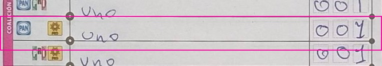 |
| 094821C0200 | REPRESENTANTES | 62 / 62 | 2 | - | routed |  |  |
| 094821C0200 | SACADOS | 388 / 388 | 386 | - | routed |  | 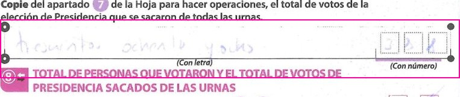 |
| 094821C0200 | SOBRANTES | 0 / 0 | 242 | - | routed |  | 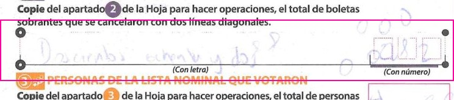 |
| 094821C0200 | TOTAL | 388 / 388 | 386 | - | routed |  | 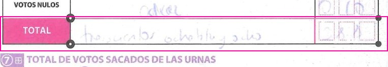 |
| 094821C0200 | VOTARON | 342 / 342 | 392 | - | routed |  | 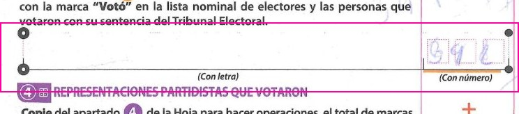 |
| 101300B0100 | MORENA | 10 / 2 | 210 | 210 | routed |  |  |
| 101300B0100 | PAN_PRI | 0 / 0 | 1 | 1 | routed |  |  |
| 101300B0100 | PVEM_MORENA | 0 / 1 | 1 | 1 | routed |  |  |
| 101300B0100 | PVEM_PT_MORENA | 6 / 0 | 8 | 8 | routed |  |  |
| 101300B0100 | REPRESENTANTES | None / None | 2 | - | routed |  |  |
| 101300B0100 | SOBRANTES | None / None | 238 | - | routed |  | 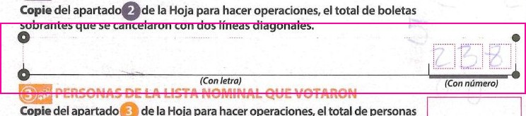 |
| 101300B0100 | VOTARON | None / None | 295 | - | routed |  | 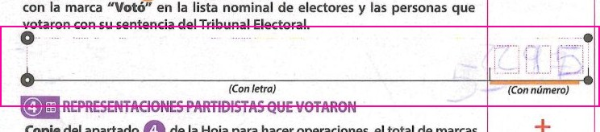 |
| 110451C0100 | NULOS | 0 / None | 6 | 6 | routed |  | 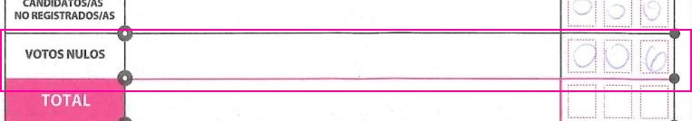 |
| 110451C0100 | PAN_PRI | 202 / None | 2 | 2 | routed |  | 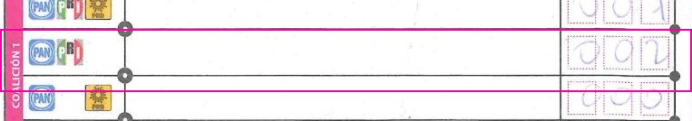 |
| 110451C0100 | PAN_PRI_PRD | 202 / None | 7 | 7 | routed |  | 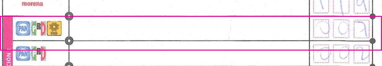 |
| 110451C0100 | PRD | 93 / None | 3 | 3 | routed |  | 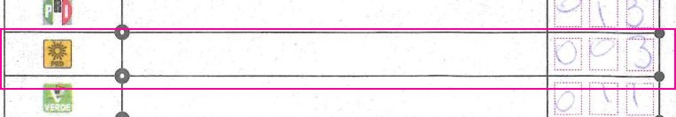 |
| 110451C0100 | PRI | 213 / None | 13 | 13 | routed |  |  |
| 110451C0100 | PT | 95 / None | 5 | 5 | routed |  |  |
| 110451C0100 | PVEM_PT_MORENA | 97 / None | 7 | 7 | routed |  | 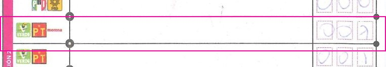 |
| 110922C0100 | PVEM | 54 / 54 | 51 | 51 | routed |  | 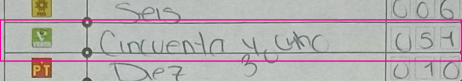 |
| 111666B0100 | PAN | 72 / 72 | 92 | 92 | routed |  | 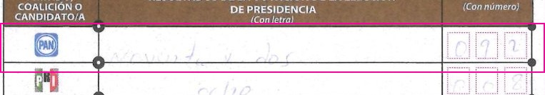 |
| 111666B0100 | PAN_PRD | None / None | 0 | 0 | routed |  |  |
| 111666B0100 | PAN_PRI | None / None | 0 | 1 | routed |  | 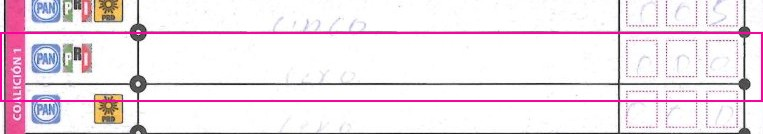 |
| 111666B0100 | PRI_PRD | None / None | 0 | 0 | routed |  |  |
| 111666B0100 | PT | 4 / 4 | 6 | 5 | routed |  |  |
| 111666B0100 | PT_MORENA | None / None | 0 | 3 | routed |  | 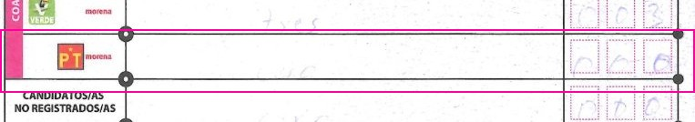 |
| 111666B0100 | PVEM_PT | 10 / 10 | 1 | 0 | routed |  | 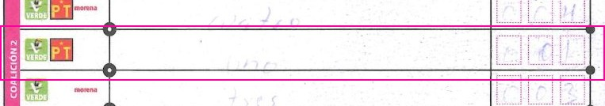 |
| 111666B0100 | REPRESENTANTES | 103 / None | 3 | - | routed |  | 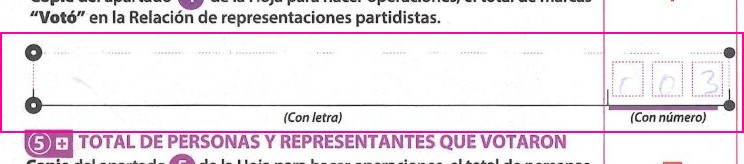 |
| 111666B0100 | SOBRANTES | 123 / None | 183 | - | routed |  |  |
| 111666B0100 | VOTARON | None / None | 238 | - | routed |  | 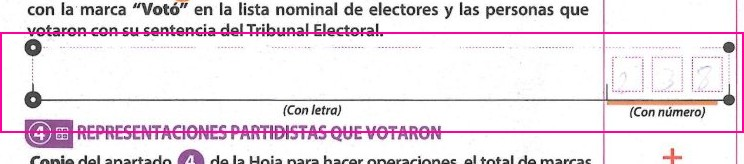 |
| 111927C0400 | PRD | 7 / 1 | 1 | 1 | routed |  |  |
| 111927C0400 | PRI | 78 / 18 | 18 | 18 | routed |  |  |
| 120867B0100 | PVEM | 151 / 153 | 153 | 151 | routed |  | 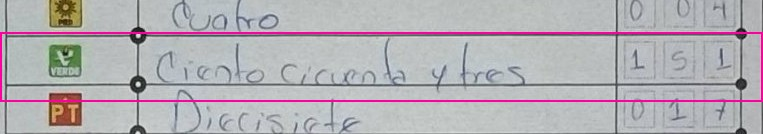 |
| 121565B0100 | REPRESENTANTES | None / None | 0 | - | routed |  | 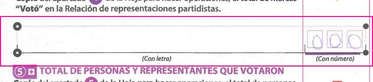 |
| 122292C0100 | NO_REGISTRADAS | 9 / 9 | 0 | 0 | routed |  | 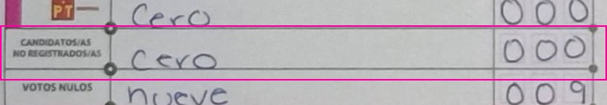 |
| 122292C0100 | NULOS | 252 / 252 | 9 | 9 | routed |  | 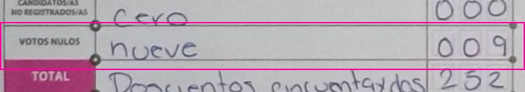 |
| 122292C0100 | TOTAL | None / None | 252 | - | routed |  | 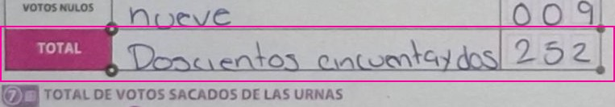 |
| 122655C0100 | PRI | 23 / 23 | 123 | 123 | routed |  |  |
| 130704B0100 | SACADOS | 376 / 370 | 370 | - | routed |  | 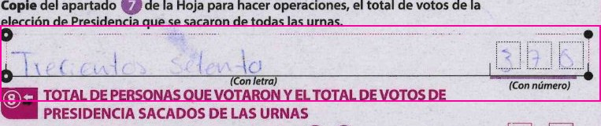 |
| 130704B0100 | SOBRANTES | 203 / 213 | 213 | - | routed |  | 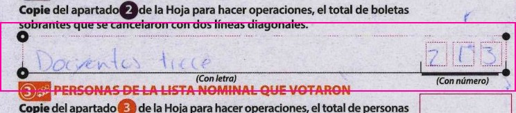 |
| 131052B0100 | SACADOS | None / 355 | 355 | - | routed |  | 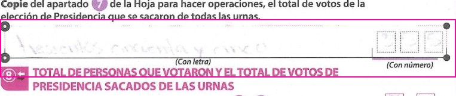 |
| 131324C0200 | MC | 90 / 40 | 40 | 40 | routed |  |  |
| 131324C0200 | NULOS | 15 / 0 | 0 | 15 | routed |  | 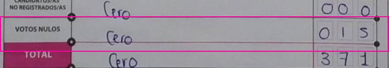 |
| 131374C0200 | PAN_PRI | 80 / 0 | 0 | 1 | routed |  | 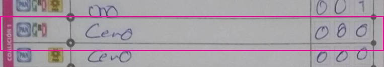 |
| 131374C0200 | PRI | 27 / 20 | 21 | 21 | routed |  |  |
| 131468C0100 | SACADOS | 354 / 4 | 352 | - | routed |  | 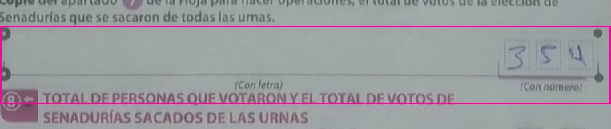 |
| 131468C0100 | TOTAL | 354 / 354 | 352 | - | routed |  | 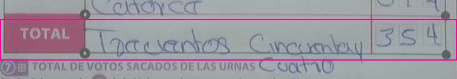 |
| 140330C0200 | MC | None / 69 | 69 | 68 | routed |  |  |
| 140330C0200 | MORENA | None / 210 | 210 | 210 | routed |  |  |
| 140330C0200 | NO_REGISTRADAS | None / 0 | 0 | 0 | routed |  |  |
| 140330C0200 | NULOS | None / 14 | 14 | 15 | routed |  |  |
| 140330C0200 | PAN | None / 10 | 10 | 10 | routed |  |  |
| 140330C0200 | PAN_PRD | None / 0 | 0 | 0 | routed |  |  |
| 140330C0200 | PAN_PRI | None / 0 | 0 | 0 | routed |  |  |
| 140330C0200 | PAN_PRI_PRD | None / 2 | 2 | 2 | routed |  |  |
| 140330C0200 | PRD | None / 5 | 5 | 5 | routed |  |  |
| 140330C0200 | PRI | None / 28 | 28 | 29 | routed |  |  |
| 140330C0200 | PRI_PRD | None / 0 | 0 | 0 | routed |  |  |
| 140330C0200 | PT | None / 18 | 18 | 18 | routed |  |  |
| 140330C0200 | PT_MORENA | None / 2 | 2 | 2 | routed |  |  |
| 140330C0200 | PVEM | None / 16 | 16 | 14 | routed |  |  |
| 140330C0200 | PVEM_MORENA | None / 2 | 2 | 2 | routed |  |  |
| 140330C0200 | PVEM_PT | None / 1 | 1 | 3 | routed |  |  |
| 140330C0200 | PVEM_PT_MORENA | None / 8 | 8 | 8 | routed |  |  |
| 140330C0200 | REPRESENTANTES | None / None | 1 | - | routed |  |  |
| 140330C0200 | SACADOS | 383 / None | 3 | - | routed |  |  |
| 140330C0200 | TOTAL | None / 383 | 383 | - | routed |  |  |
| 141113C0100 | SOBRANTES | 256 / 256 | 255 | - | routed |  |  |
| 141113C0100 | VOTARON | 441 / 441 | 497 | - | routed |  |  |
| 141155C0100 | VOTARON | 282 / 287 | 287 | - | routed |  |  |
| 142210C0400 | PAN_PRI_PRD | 7 / 1 | 1 | 2 | routed |  |  |
| 142210C0400 | PVEM_MORENA | 7 / 1 | 1 | 1 | routed |  |  |
| 142210C0400 | SACADOS | 74 / 14 | 14 | - | routed |  |  |
| 142479C0100 | SACADOS | None / 265 | 265 | - | routed |  |  |
| 143587B0100 | MC | 106 / 100 | 100 | 100 | routed |  |  |
| 143587B0100 | SOBRANTES | 301 / 361 | 361 | - | routed |  |  |
| 151055C0200 | MORENA | 273 / 273 | 275 | 275 | routed |  |  |
| 151055C0200 | PRI | 39 / 39 | 34 | 34 | routed |  |  |
| 151055C0200 | REPRESENTANTES | 96 / None | 6 | - | routed |  |  |
| 151606C0100 | REPRESENTANTES | None / None | 3 | - | routed |  |  |
| 151606C0100 | SOBRANTES | None / None | 244 | - | routed |  |  |
| 151606C0100 | VOTARON | None / None | 402 | - | routed |  |  |
| 152095B0100 | NULOS | 0 / 6 | 6 | 6 | routed |  |  |
| 152683C0200 | PAN_PRI | 1 / 0 | 0 | 1 | routed |  |  |
| 153572B0100 | SACADOS | 341 / 1 | 1 | - | routed |  |  |
| 153782C0200 | VOTARON | 425 / 420 | 421 | - | routed |  |  |
| 154237C0200 | SACADOS | None / None | 422 | - | routed |  |  |
| 154383E0100 | SOBRANTES | 110 / 115 | 115 | - | routed |  |  |
| 154448C0100 | REPRESENTANTES | 804 / None | 4 | - | routed |  |  |
| 154476C0300 | SOBRANTES | 370 / None | 371 | - | routed |  |  |
| 155026C0100 | REPRESENTANTES | 0 / None | 5 | - | routed |  |  |
| 155026C0100 | VOTARON | 369 / None | 364 | - | routed |  |  |
| 155191C0100 | VOTARON | 785 / 785 | 185 | - | routed |  |  |
| 155673C0300 | VOTARON | 314 / 314 | 164 | - | routed |  |  |
| 155940C0100 | PRD | 1 / 4 | 4 | 4 | routed |  |  |
| 156371B0100 | PRD | 6 / 6 | 0 | 0 | routed |  |  |
| 160026B0100 | SOBRANTES | 47 / 47 | 247 | - | routed |  |  |
| 160073C0100 | PRI_PRD | 7 / 0 | 0 | 0 | routed |  |  |
| 162776C0100 | SACADOS | 344 / 344 | 331 | - | routed |  |  |
| 180307B0100 | SOBRANTES | 224 / None | 214 | - | routed |  |  |
| 190150C0100 | PT_MORENA | 4 / 1 | 1 | 1 | routed |  |  |
| 200475C0100 | PRD | 7 / 1 | 1 | 1 | routed |  |  |
| 201201B0100 | SACADOS | 716 / 716 | 316 | - | routed |  |  |
| 201201B0100 | VOTARON | 716 / 716 | 316 | - | routed |  |  |
| 202005C0200 | MORENA | 75 / 75 | 15 | 75 | routed |  |  |
| 211671B0100 | PAN | 68 / 58 | 58 | 58 | routed |  |  |
| 212668C0300 | SOBRANTES | 300 / None | 379 | - | accepted |  |  |
| 220225C0200 | MORENA | 240 / 240 | 290 | 239 | routed |  |  |
| 220225C0200 | NO_REGISTRADAS | None / None | 3 | 3 | routed |  |  |
| 220313C0300 | SACADOS | 0 / 0 | 527 | - | routed |  |  |
| 220497B0100 | MORENA | 197 / None | 199 | 198 | routed |  |  |
| 220497B0100 | NO_REGISTRADAS | 8 / None | Ilegible | 4 | routed |  |  |
| 220497B0100 | PAN_PRI | 6 / None | 5 | 4 | routed |  |  |
| 220497B0100 | PT | 7 / None | 17 | 17 | routed |  |  |
| 220497B0100 | PVEM | 26 / None | 20 | 20 | routed |  |  |
| 220497B0100 | PVEM_PT | 4 / None | Ilegible | 4 | routed |  |  |
| 220497B0100 | PVEM_PT_MORENA | 5 / None | Ilegible | 21 | routed |  |  |
| 220497B0100 | REPRESENTANTES | 104 / None | 4 | - | routed |  |  |
| 220497B0100 | SOBRANTES | 318 / None | 348 | - | routed |  |  |
| 240035C0100 | NULOS | 73 / 13 | 13 | 13 | routed |  |  |
| 240679B0100 | PT_MORENA | 4 / 2 | 2 | 2 | routed |  |  |
| 241393C0100 | SACADOS | 376 / None | 370 | - | routed |  |  |
| 241393C0100 | TOTAL | 376 / 370 | 370 | - | routed |  |  |
| 250767B0100 | REPRESENTANTES | 3 / 3 | 393 | - | routed |  |  |
| 250767B0100 | SOBRANTES | None / None | 390 | - | routed |  |  |
| 250767B0100 | VOTARON | 390 / 300 | 3 | - | routed |  |  |
| 251701B0100 | MC | 68 / None | Ilegible | 8 | routed |  |  |
| 251701B0100 | MORENA | 189 / 189 | Ilegible | 149 | routed |  |  |
| 251701B0100 | NULOS | 67 / 76 | Ilegible | 6 | routed |  |  |
| 251701B0100 | PAN | 31 / None | Ilegible | 31 | routed |  |  |
| 251701B0100 | SOBRANTES | 298 / 208 | 208 | - | routed |  |  |
| 253060B0100 | REPRESENTANTES | None / None | 2 | - | routed |  |  |
| 253737B0100 | SACADOS | None / None | 178 | - | routed |  |  |
| 260214C0300 | PAN_PRI | 0 / 1 | 1 | 1 | routed |  |  |
| 260214C0300 | SOBRANTES | 429 / 429 | 479 | - | routed |  |  |
| 270180B0100 | SOBRANTES | 255 / 255 | 253 | - | routed |  |  |
| 270180B0100 | TOTAL | 113 / 413 | 413 | - | routed |  |  |
| 270281B0100 | SACADOS | 344 / 344 | Sin dato | - | routed |  |  |
| 270281B0100 | TOTAL | 344 / 344 | Sin dato | - | routed |  |  |
| 270844C0100 | NO_REGISTRADAS | 11 / 11 | 0 | 0 | routed |  |  |
| 270844C0100 | REPRESENTANTES | 66 / 0 | 0 | - | routed |  |  |
| 270844C0100 | SOBRANTES | 272 / None | 342 | - | routed |  |  |
| 270971C0400 | PRD | 9 / 2 | 2 | 2 | routed |  |  |
| 270971C0400 | PVEM_MORENA | None / None | 1 | 1 | routed |  |  |
| 270971C0400 | PVEM_PT | 1 / 1 | Sin dato | 0 | routed |  |  |
| 280078B0100 | REPRESENTANTES | 12 / 12 | 10 | - | routed |  |  |
| 280078B0100 | VOTARON | 411 / 411 | 401 | - | routed |  |  |
| 290625B0100 | PRI_PRD | 0 / 0 | 9 | 1 | routed |  |  |
| 290625B0100 | PT_MORENA | 3 / 1 | 0 | 5 | routed |  |  |
| 290625B0100 | PVEM_MORENA | 5 / 9 | 3 | 16 | routed |  |  |
| 290625B0100 | PVEM_PT | 1 / 0 | 5 | 1 | routed |  |  |
| 290625B0100 | PVEM_PT_MORENA | 9 / 0 | 1 | 14 | routed |  |  |
| 300828B0100 | PRI | 26 / 26 | 20 | 20 | routed |  |  |
| 301477B0100 | MORENA | 128 / 128 | 228 | 128 | routed |  |  |
| 301480B0100 | SACADOS | 422 / 422 | 420 | - | routed |  |  |
| 302191C0100 | PAN | 66 / 6 | 6 | 6 | routed |  |  |
| 302191C0100 | SACADOS | None / 209 | 249 | - | routed |  |  |
| 302191C0100 | SOBRANTES | 201 / 201 | Ilegible | - | routed |  |  |
| 302191C0100 | VOTARON | 207 / 207 | Ilegible | - | routed |  |  |
| 303152C0100 | SOBRANTES | 242 / 242 | 244 | - | routed |  |  |
| 303152C0100 | VOTARON | 398 / 388 | 388 | - | routed |  |  |
| 304034C0100 | SACADOS | None / 0 | 0 | - | routed |  |  |
| 304395B0100 | PRD | 1 / 2 | 2 | 2 | routed |  |  |
| 311026C0200 | SOBRANTES | 206 / None | 306 | - | routed |  |  |
| 320267C0100 | MORENA | 94 / 91 | 91 | 89 | routed |  |  |
| 321139B0100 | REPRESENTANTES | None / None | 0 | - | routed |  |  |
