# Adjudication sheet (Amendment 2 b)

Every field where the reader disagrees with the PREP capture. Crops are cut from masked pages only.
Verdict: one of model_right, capture_right, neither, paper_ambiguous, unreadable, crop_wrong. Edit `verdicts.json` (or `adjudication.jsonl`).
`neither` = the paper shows a value that is neither the model's nor the capture's (model wrong, capture also off).
Adjudicated by a reviewer looking at the published crops; every crop is in results/adjudication/ for anyone to check.
Vote rows are named Option 01 to Option 15 in printed order (machine files keep INE's column names).

| clave | field | model digits / words | PREP | Computos | form | verdict | paper | evidence (what is written) | crop |
|---|---|---|---|---|---|---|---|---|---|
| 010469C0400 | Unused ballots | 239 / 239 | 234 | - | accepted | capture_right | 234 | words "doscientos treinta y cuatro", boxes 2 3 4 | 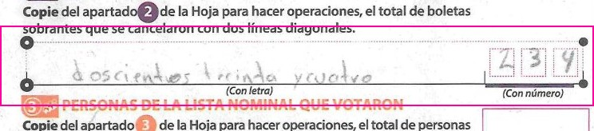 |
| 020584C0100 | Unregistered candidates | None / None | 0 | 0 | routed | paper_ambiguous | blank | row left blank: no words, empty boxes; model null vs PREP 0 is the blank=0 convention, not a misread | 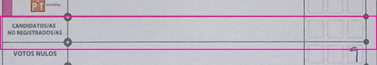 |
| 020584C0100 | Option 15 | None / None | 0 | 2 | routed | paper_ambiguous | blank | row left blank: no words, empty boxes; blank=0 convention (Computos later certified 2) | 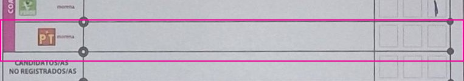 |
| 020584C0100 | Option 13 | None / None | 0 | 1 | routed | paper_ambiguous | blank | row left blank: no words, empty boxes; blank=0 convention (Computos later certified 1) | 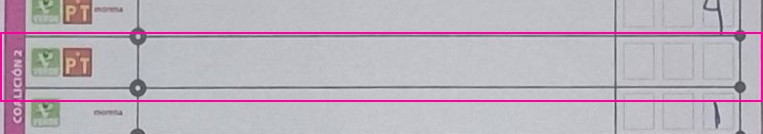 |
| 021309B0100 | Unused ballots | 31 / 431 | 431 | - | routed | capture_right | 431 | words "cuatrocientos treinta y uno", boxes ? 3 1 (first box under the label sticker) | 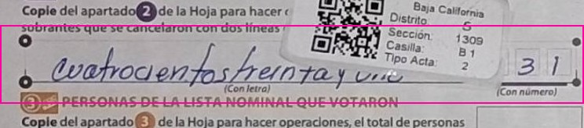 |
| 021600C0100 | Option 01 | 13 / 15 | 15 | 15 | routed | capture_right | 15 | words "Quince", boxes 0 1 5 | 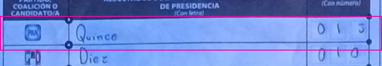 |
| 021600C0100 | Ballots taken from the boxes | 601 / None | 326 | - | routed | model_right | 601 | no words, boxes 6 0 1 (PREP keyed 326) | 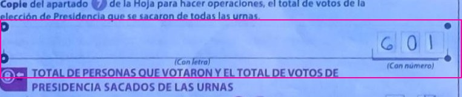 |
| 021626B0100 | Option 06 | 0 / 21 | 22 | 28 | routed | neither | 28 | faint pencil: words "Veintiocho", boxes ? 2 8; model 0, PREP 22 (Computos 28) | 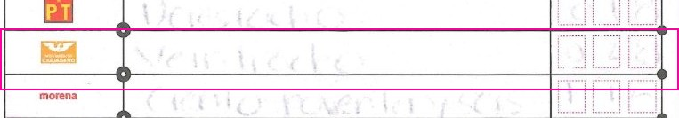 |
| 021626B0100 | Option 07 | 100 / 100 | Ilegible | 199 | routed | neither | 196 | faint pencil: words "ciento noventa y seis", boxes 1 9 6 (faint); model 100, PREP Ilegible (Computos 199) | 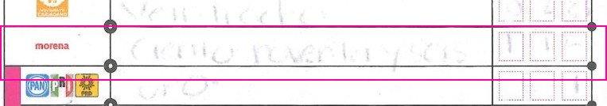 |
| 021626B0100 | Null votes | 0 / 1 | Ilegible | 1 | routed | neither | 1 | faint: words "Uno", boxes 0 0 1; model digits 0 (words 1), PREP Ilegible | 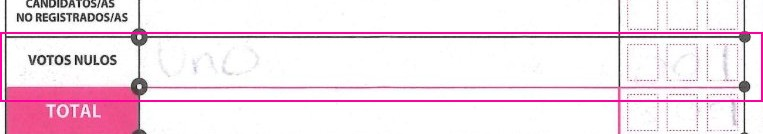 |
| 021626B0100 | Option 08 | 0 / 1 | Ilegible | 1 | routed | neither | 1 | faint: words "uno", boxes _ _ 1; model digits 0, PREP Ilegible | 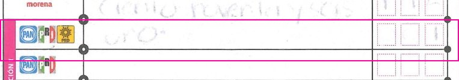 |
| 021626B0100 | Option 03 | 0 / 1 | 1 | 1 | routed | capture_right | 1 | faint pencil: words "Uno", boxes _ 0 1; model 0 | 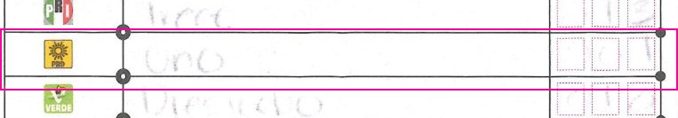 |
| 021626B0100 | Option 02 | 0 / 0 | 13 | 13 | routed | capture_right | 13 | faint pencil: words "trece", boxes _ 1 3; model 0 | 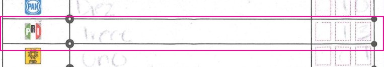 |
| 021626B0100 | Option 05 | 0 / 0 | 18 | 18 | routed | capture_right | 18 | faint pencil: words "Dieciocho", boxes 0 1 8; model 0 | 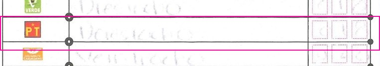 |
| 021626B0100 | Option 15 | 0 / 4 | Ilegible | 4 | routed | neither | 4 | faint pencil: words "cuatro", boxes _ _ 4; model digits 0 (words 4), PREP Ilegible | 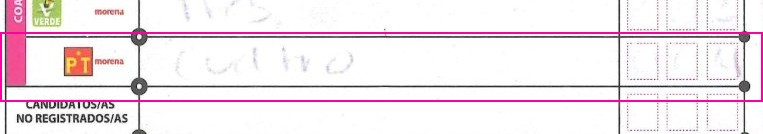 |
| 021626B0100 | Option 04 | 0 / 0 | 18 | 18 | routed | capture_right | 18 | faint pencil: words "Dieciocho", boxes 0 1 8; model 0 | 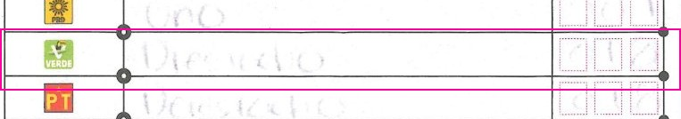 |
| 021626B0100 | Option 14 | 0 / 0 | Ilegible | 3 | routed | neither | 3 | faint pencil: words "tres", boxes _ _ 3; model 0, PREP Ilegible | 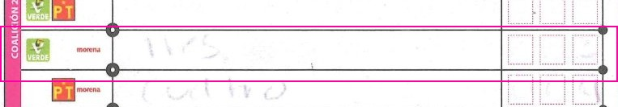 |
| 021626B0100 | Ballots taken from the boxes | 9 / 9 | Ilegible | - | routed | neither | 309 | faint pencil: words "trescientos nueve", boxes 3 0 9; model 9, PREP Ilegible | 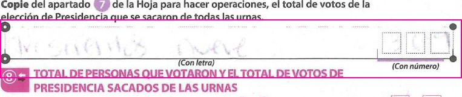 |
| 021937C0100 | Option 06 | 1 / None | 11 | 11 | routed | capture_right | 11 | no words, boxes 0 1 1; model 1 | 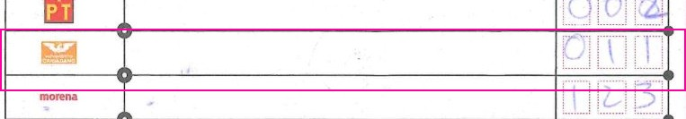 |
| 021937C0100 | Option 04 | 1 / None | 11 | 11 | routed | capture_right | 11 | no words, boxes 0 1 1; model 1 | 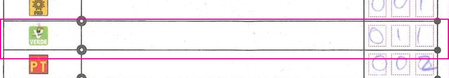 |
| 021937C0100 | Option 12 | 0 / None | 10 | 10 | routed | capture_right | 10 | no words, boxes 0 1 0; model 0 | 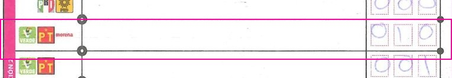 |
| 030150B0100 | Representatives who voted | 104 / None | 4 | - | routed | capture_right | 4 | no words, boxes 0 0 4; model 104 | 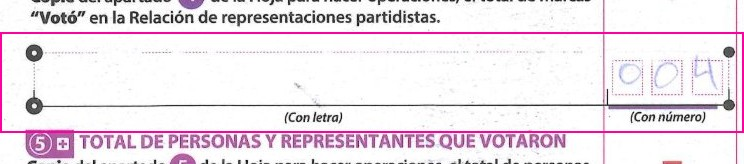 |
| 030150B0100 | Unused ballots | 77 / None | 277 | - | routed | capture_right | 277 | no words, boxes 2 7 7; model 77 | 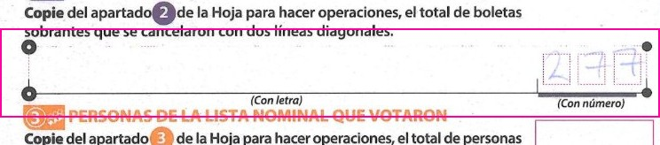 |
| 050397B0100 | Ballots taken from the boxes | None / 3 | 453 | - | routed | model_right | blank | no words, boxes empty (field left blank on the paper); PREP keyed 453, model null | 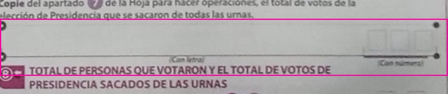 |
| 050815B0100 | Option 07 | 175 / 175 | 75 | 175 | routed | model_right | 175 | words "ciento setenta y cinco", boxes 1 7 5 (PREP keyed 75; Computos 175) | 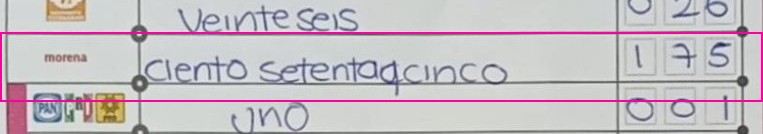 |
| 070144C0200 | Option 11 | None / None | 2 | 0 | routed | capture_right | 2 | words "Dos", boxes 0 0 2; model null | 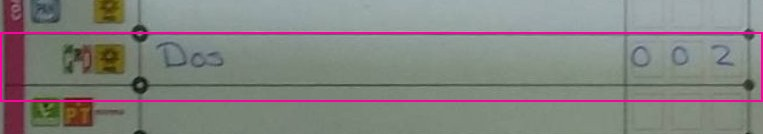 |
| 070144C0200 | Option 12 | 2 / 2 | Sin dato | 17 | routed | capture_right | blank | row blank (no words, empty boxes); PREP "Sin dato"; model 2 (took "Dos" from the row above) | 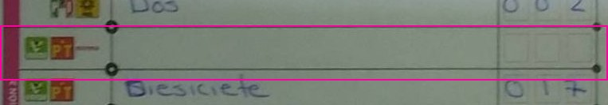 |
| 070154C0100 | Option 07 | 254 / None | 354 | 368 | routed | capture_right | 354 | no words, boxes 3 5 4; model 254 | 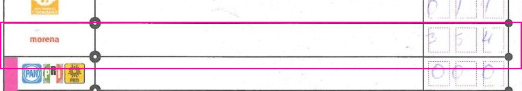 |
| 070154C0100 | Null votes | 61 / None | 30 | 32 | routed | capture_right | 30 | no words, boxes 0 3 0; model 61 | 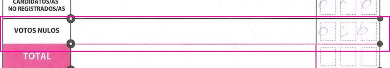 |
| 070154C0100 | Option 01 | 75 / None | 15 | 15 | routed | capture_right | 15 | no words, boxes 0 1 5 (middle 1 traced heavily, possibly over another stroke); model 75 | 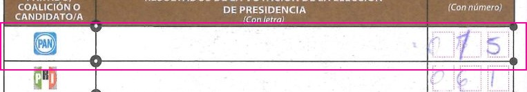 |
| 070154C0100 | Option 11 | 5 / None | 3 | 1 | routed | capture_right | 3 | no words, boxes 0 0 3; model 5 | 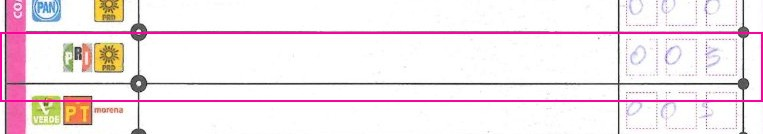 |
| 070154C0100 | Option 05 | 41 / None | 91 | 95 | routed | paper_ambiguous | 91? | no words, boxes 0 ? 1: middle digit is a heavy loop over a stroke, reads as 9 or 4 (correction); model 41, PREP 91 (Computos 95) | 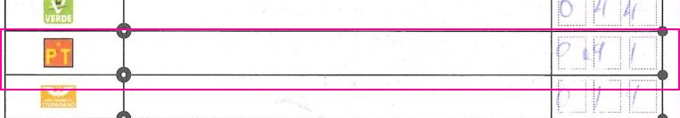 |
| 070154C0100 | Option 15 | 0 / None | 1 | 7 | routed | capture_right | 1 | no words, boxes 0 0 1; model 0 | 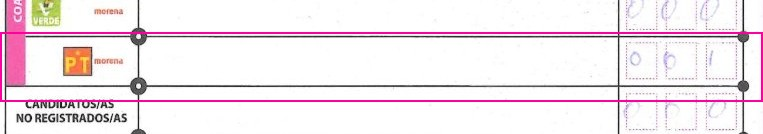 |
| 070207C0100 | Option 06 | 47 / 47 | Ilegible | 47 | routed | model_right | 47 | very faint pencil (PREP Ilegible): words "Cuarenta y siete", boxes 0 4 7 (Computos 47) | 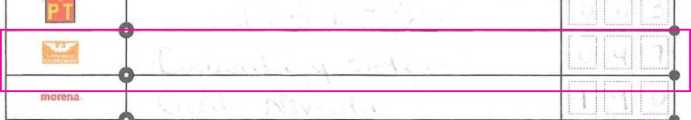 |
| 070207C0100 | Option 07 | 140 / 140 | Ilegible | 191 | routed | neither | 190 | very faint pencil: words "Ciento Noventa", boxes 1 9 0; model 140, PREP Ilegible (Computos 191) | 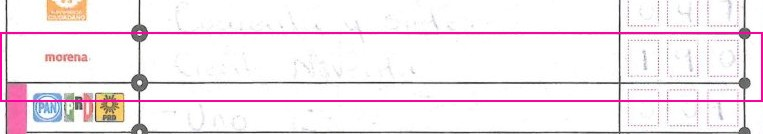 |
| 070207C0100 | Unregistered candidates | 0 / 0 | Ilegible | 1 | routed | unreadable |  | very faint pencil, words illegible, boxes look like empty ovals/0s; cannot decide (PREP Ilegible, model 0, Computos 1) | 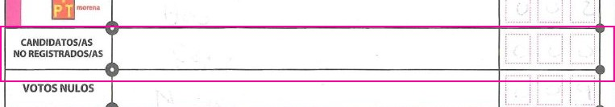 |
| 070207C0100 | Null votes | 4 / 4 | Ilegible | 7 | routed | unreadable |  | very faint pencil; last box 9 or 4, words illegible (PREP Ilegible, model 4, Computos 7) |  |
| 070207C0100 | Option 10 | 0 / 0 | Ilegible | 0 | routed | model_right | 0 | faint pencil: words "Cero", boxes 0 0 0; PREP Ilegible (Computos 0) | 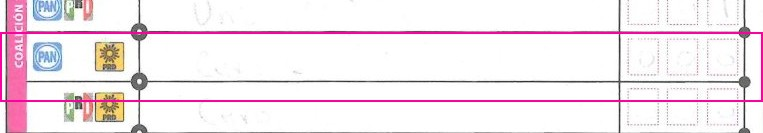 |
| 070207C0100 | Option 09 | 0 / 0 | Ilegible | 1 | routed | neither | 1 | faint pencil: words "Uno", boxes _ _ 1; model 0, PREP Ilegible (Computos 1) | 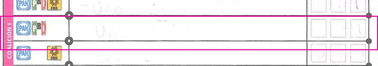 |
| 070207C0100 | Option 08 | 1 / 1 | Ilegible | 1 | routed | model_right | 1 | faint pencil: words "Uno", boxes _ _ 1; PREP Ilegible (Computos 1) | 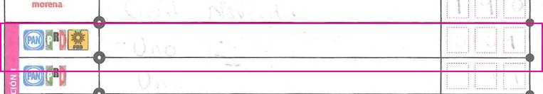 |
| 070207C0100 | Option 03 | 0 / 0 | Ilegible | 3 | routed | neither | 3 | faint pencil: words "Tres", boxes 0 0 3; model 0, PREP Ilegible (Computos 3) | 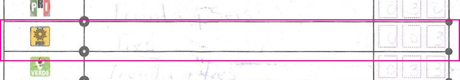 |
| 070207C0100 | Option 02 | 20 / 20 | Ilegible | 36 | routed | neither | 36 | faint pencil: words "Treinta y Seis", boxes 0 3 6; model 20, PREP Ilegible (Computos 36) | 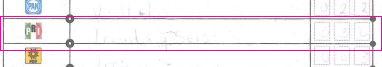 |
| 070207C0100 | Option 11 | 0 / 0 | Ilegible | 0 | routed | model_right | 0 | faint pencil: words "Cero", boxes 0 0 0; PREP Ilegible (Computos 0) | 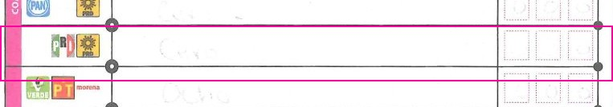 |
| 070207C0100 | Option 05 | 0 / 0 | Ilegible | 63 | routed | neither | 63 | very faint pencil: words illegible ("Sesenta y tres"?), boxes 0 6 3; model 0, PREP Ilegible (Computos 63) | 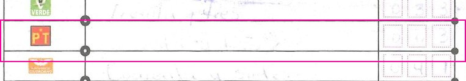 |
| 070207C0100 | Option 15 | 0 / 0 | Ilegible | 3 | routed | neither | 3 | very faint pencil: boxes 0 0 3, words illegible; model 0, PREP Ilegible (Computos 3) | 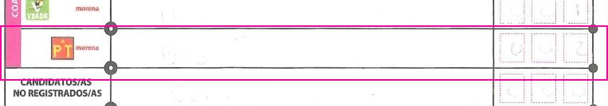 |
| 070207C0100 | Option 04 | 22 / 22 | Ilegible | 33 | routed | neither | 33 | faint pencil: words "Treinta y tres", boxes 0 3 3; model 22, PREP Ilegible (Computos 33) | 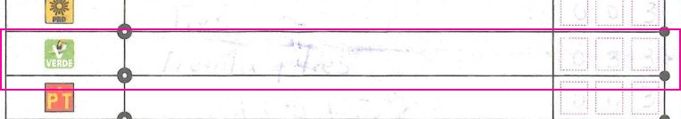 |
| 070207C0100 | Option 14 | 0 / 0 | Ilegible | 1 | routed | neither | 1 | faint pencil: words "Uno", boxes 0 0 1; model 0, PREP Ilegible (Computos 1) | 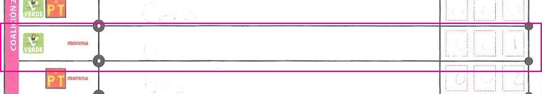 |
| 070207C0100 | Option 13 | 0 / 0 | Ilegible | 0 | routed | model_right | 0 | faint pencil: words "Cero", boxes 0 0 0; PREP Ilegible (Computos 0) | 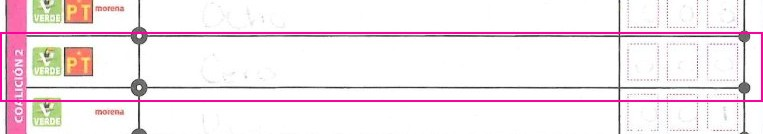 |
| 070207C0100 | Option 12 | 8 / 8 | Ilegible | 7 | routed | model_right | 8 | faint pencil: words "Ocho", boxes 0 0 8 (faint); PREP Ilegible (Computos 7, after recount) | 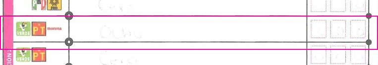 |
| 070207C0100 | Representatives who voted | 2 / 2 | 3 | - | routed | capture_right | 3 | no words, faint boxes 0 0 3; model 2 |  |
| 070207C0100 | Ballots taken from the boxes | 416 / 416 | Ilegible | - | routed | model_right | 416 | no words, boxes 4 1 6; PREP Ilegible | 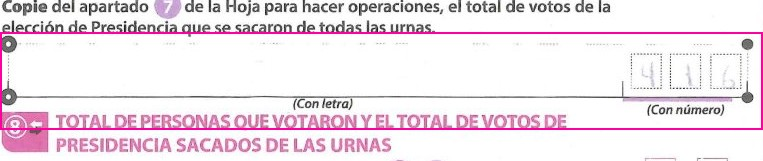 |
| 070207C0100 | Unused ballots | 27 / 27 | 277 | - | routed | capture_right | 277 | faint words "Doscientos setenta y siete", boxes 2 7 7; model 27 |  |
| 070207C0100 | TOTAL | 416 / 416 | Ilegible | - | routed | model_right | 416 | faint words "Cuatrocientos dieciseis", boxes 4 1 6; PREP Ilegible | 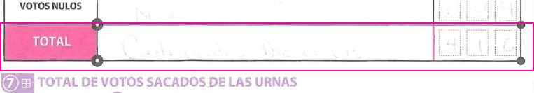 |
| 070282C0200 | Option 13 | 8 / 7 | 7 | 7 | routed | paper_ambiguous | 7/8 | words "Siete", boxes 0 0 8 (8 looks written over a 7); model 8, PREP 7 (Computos 7) |  |
| 070470E0100 | Option 07 | 202 / 203 | 203 | 203 | routed | paper_ambiguous | 203/202 | words "DOSCIENTOS TRES", boxes 2 0 2 (last glyph reads 2); model 202, PREP 203 (Computos 203) |  |
| 070470E0100 | Option 05 | 183 / 185 | 185 | 185 | routed | capture_right | 185 | words "CIENTO OCHENTA Y CINCO", boxes 1 8 5 (writer's flat-top 5, same as the CINCO row below); model 183 |  |
| 070470E0100 | Representatives who voted | 100 / 100 | Ilegible | - | routed | paper_ambiguous | 0? | no words, boxes 0 0 0 with an extra stroke on the first 0 (possible correction); model 100, PREP Ilegible |  |
| 070470E0100 | Voters on the list | 420 / 420 | Ilegible | - | routed | model_right | 420 | no words, boxes 4 2 0 (heavy retrace on 2 and 0); PREP Ilegible |  |
| 071709C0100 | Option 01 | 94 / 4 | 4 | 93 | routed | paper_ambiguous | 4/94 | words "Cuatro", boxes 0 9 4; model 94, PREP 4 (Computos 93) |  |
| 071709C0100 | Option 02 | 31 / 30 | 30 | 31 | routed | paper_ambiguous | 30/31 | words "Treinta", boxes 0 3 1 (middle digit corrected); model 31, PREP 30 (Computos 31) |  |
| 071709C0100 | Voters on the list | 394 / None | 399 | - | routed | capture_right | 399 | no words, boxes 3 9 9; model 394 |  |
| 072354B0100 | Option 02 | 21 / 24 | 24 | 24 | routed | paper_ambiguous | 24/21 | words "veinticuatro", boxes 0 2 1 (last glyph reads 1, could be an open 4); model 21, PREP 24 (Computos 24) |  |
| 072354B0100 | Unused ballots | 299 / None | 249 | - | routed | capture_right | 249 | no words, boxes 2 4 9; model 299 |  |
| 080305B0100 | Option 02 | 15 / None | Ilegible | 15 | routed | model_right | 15 | no words, faint boxes 0 1 5; PREP Ilegible (Computos 15) |  |
| 080310B0100 | Unused ballots | 180 / 180 | 480 | - | accepted | model_right | 180 | words "CIENTO OCHENTA", boxes 1 8 0 (PREP keyed 480) |  |
| 080336B0100 | Ballots taken from the boxes | None / None | 193 | - | routed | model_right | blank | no words, boxes empty (left blank on the paper); PREP keyed 193, model null |  |
| 080338C0100 | Option 07 | 143 / 93 | 93 | 93 | routed | capture_right | 93 | words "noventa y tres", boxes 0 9 3; model 143 |  |
| 080338C0100 | Unused ballots | 321 / 381 | 381 | - | routed | capture_right | 381 | words "trescientos ochenta y uno", boxes 3 8 1; model 321 |  |
| 083281B0100 | Unregistered candidates | None / 1 | 1 | 1 | routed | capture_right | 1 | words "Uno", boxes left empty; model digits null (words 1), PREP 1 |  |
| 090955C0200 | Representatives who voted | 100 / None | 0 | - | routed | capture_right | 0 | no words, boxes 0 0 0; model 100 |  |
| 090955C0200 | Unused ballots | 200 / None | 206 | - | routed | capture_right | 206 | no words, boxes 2 0 6; model 200 |  |
| 092366B0100 | Unused ballots | 497 / 497 | 197 | - | routed | capture_right | 197 | words "Ciento noventa y siete", boxes 1 9 7; model 497 |  |
| 093478C0100 | Option 02 | 629 / 29 | 29 | 29 | routed | paper_ambiguous | 29/629 | words "veinti nueve", boxes 6 2 9; model 629, PREP 29 (Computos 29) |  |
| 093831B0100 | Option 06 | 39 / 39 | Ilegible | 39 | routed | model_right | 39 | faint pencil (PREP Ilegible): words "treinta y nueve", boxes 0 3 9 (Computos 39) |  |
| 093831B0100 | Option 07 | 199 / 199 | Ilegible | 198 | routed | model_right | 199 | faint pencil: words "ciento noventa y nueve", boxes 1 9 9; PREP Ilegible (Computos 198) |  |
| 093831B0100 | Unregistered candidates | 0 / 0 | Ilegible | 0 | routed | model_right | 0 | faint pencil: words "Cero", boxes 0 0 0; PREP Ilegible |  |
| 093831B0100 | Null votes | 9 / 9 | Ilegible | 10 | routed | model_right | 9 | faint pencil: words "Nueve", boxes 0 0 9; PREP Ilegible (Computos 10) |  |
| 093831B0100 | Option 10 | 0 / 0 | Ilegible | 0 | routed | model_right | 0 | faint pencil: words "Cero", boxes 0 0 0 (middle box scribbled); PREP Ilegible |  |
| 093831B0100 | Option 09 | 1 / 1 | Ilegible | 1 | routed | model_right | 1 | faint pencil: words "Uno", boxes 0 0 1; PREP Ilegible |  |
| 093831B0100 | Option 08 | 7 / 7 | Ilegible | 7 | routed | model_right | 7 | faint pencil: words "Siete", boxes 0 0 7; PREP Ilegible |  |
| 093831B0100 | Option 03 | 7 / 7 | Ilegible | 7 | routed | model_right | 7 | faint pencil: words "siete", boxes 0 0 7; PREP Ilegible |  |
| 093831B0100 | Option 11 | 0 / 0 | Ilegible | 0 | routed | paper_ambiguous | 0/4? | faint pencil: words "cero", boxes 0 0 + a 4-like mark in the last box; model 0, PREP Ilegible (Computos 0) |  |
| 093831B0100 | Option 05 | 8 / 8 | Ilegible | 8 | routed | model_right | 8 | faint pencil: words "Ocho", boxes 0 0 8; PREP Ilegible (Computos 8) |  |
| 093831B0100 | Option 15 | 5 / 5 | Ilegible | 5 | routed | model_right | 5 | faint pencil: words "cinco", boxes 0 0 5; PREP Ilegible (Computos 5) |  |
| 093831B0100 | Option 04 | 11 / 11 | Ilegible | 11 | routed | model_right | 11 | faint pencil: words "Once", boxes 0 1 1; PREP Ilegible (Computos 11) |  |
| 093831B0100 | Option 14 | 2 / 2 | Ilegible | 2 | routed | model_right | 2 | faint pencil: words "dos", boxes 0 0 2; PREP Ilegible (Computos 2) |  |
| 093831B0100 | Option 13 | 2 / 2 | Ilegible | 2 | routed | model_right | 2 | faint pencil: words "dos", boxes 0 0 2; PREP Ilegible (Computos 2) |  |
| 093831B0100 | Option 12 | 1 / 1 | Ilegible | 12 | routed | neither | 12 | faint pencil: words "doce", boxes 0 1 2; model 1, PREP Ilegible (Computos 12) |  |
| 093831B0100 | Ballots taken from the boxes | 388 / 388 | Ilegible | - | routed | model_right | 388 | faint pencil: words "trescientos ochenta y ocho", boxes 3 8 8; PREP Ilegible |  |
| 093831B0100 | TOTAL | 383 / 383 | Ilegible | - | routed | model_right | 383 | faint pencil: words "trescientos ochenta y tres", boxes 3 8 3; PREP Ilegible |  |
| 093975C0400 | Option 10 | 4 / 1 | 1 | 1 | routed | capture_right | 1 | words "Uno", boxes 0 0 1 (1 with a top serif); model digits 4 (words 1) |  |
| 094821C0200 | Representatives who voted | 62 / 62 | 2 | - | routed | capture_right | 2 | no words, boxes 0 0 2; model 62 |  |
| 094821C0200 | Ballots taken from the boxes | 388 / 388 | 386 | - | routed | model_right | 388 | words "trescientos ochenta y ocho", boxes 3 8 8 (PREP keyed 386) |  |
| 094821C0200 | Unused ballots | 0 / 0 | 242 | - | routed | capture_right | 242 | words "Doscientos cuarenta y dos", boxes 2 4 2 (crowded, extra 0 scribbled before); model 0 |  |
| 094821C0200 | TOTAL | 388 / 388 | 386 | - | routed | model_right | 388 | words "trescientos ochenta y ocho", boxes 3 8 8 (PREP keyed 386) |  |
| 094821C0200 | Voters on the list | 342 / 342 | 392 | - | routed | capture_right | 392 | no words, boxes 3 9 2 (looped 9); model 342 |  |
| 101300B0100 | Option 07 | 10 / 2 | 210 | 210 | routed | capture_right | 210 | words "doscientos diez" (written across two lines), boxes 2 1 0; model 10 |  |
| 101300B0100 | Option 09 | 0 / 0 | 1 | 1 | routed | capture_right | 1 | words "uno", boxes 0 0 1; model 0 |  |
| 101300B0100 | Option 14 | 0 / 1 | 1 | 1 | routed | capture_right | 1 | words "uno", boxes 0 0 1; model digits 0 (words 1) |  |
| 101300B0100 | Option 12 | 6 / 0 | 8 | 8 | routed | capture_right | 8 | words "ocho" (on the lower line, "cero" of the row above crowds in), boxes 0 0 8; model 6 |  |
| 101300B0100 | Representatives who voted | None / None | 2 | - | routed | capture_right | 2 | no words, boxes 0 0 2; model null |  |
| 101300B0100 | Unused ballots | None / None | 238 | - | routed | capture_right | 238 | no words, boxes 2 3 8; model null |  |
| 101300B0100 | Voters on the list | None / None | 295 | - | routed | capture_right | 295 | no words, faint boxes 2 9 5; model null |  |
| 110451C0100 | Null votes | 0 / None | 6 | 6 | routed | capture_right | 6 | no words, boxes 0 0 6; model 0 |  |
| 110451C0100 | Option 09 | 202 / None | 2 | 2 | routed | capture_right | 2 | no words, boxes 0 0 2 (writer's 0s have a tail and resemble 9s); model 202 |  |
| 110451C0100 | Option 08 | 202 / None | 7 | 7 | routed | capture_right | 7 | no words, boxes 0 0 7 (tailed 0s); model 202 |  |
| 110451C0100 | Option 03 | 93 / None | 3 | 3 | routed | capture_right | 3 | no words, boxes 0 0 3 (tailed 0s); model 93 |  |
| 110451C0100 | Option 02 | 213 / None | 13 | 13 | routed | capture_right | 13 | no words, boxes 0 1 3 (tailed 0); model 213 |  |
| 110451C0100 | Option 05 | 95 / None | 5 | 5 | routed | capture_right | 5 | no words, boxes 0 0 5; model 95 |  |
| 110451C0100 | Option 12 | 97 / None | 7 | 7 | routed | capture_right | 7 | no words, boxes 0 0 7 (tailed 0s); model 97 |  |
| 110922C0100 | Option 04 | 54 / 54 | 51 | 51 | routed | capture_right | 51 | words "Cincuenta y uno", boxes 0 5 1 (1 with a long flag, resembles 4); model 54 |  |
| 111666B0100 | Option 01 | 72 / 72 | 92 | 92 | routed | capture_right | 92 | faint: words "noventa y dos", boxes 0 9 2; model 72 |  |
| 111666B0100 | Option 10 | None / None | 0 | 0 | routed | capture_right | 0 | faint: words "cero", boxes 0 0 0; model null |  |
| 111666B0100 | Option 09 | None / None | 0 | 1 | routed | capture_right | 0 | faint: words "cero", boxes 0 0 0; model null (Computos 1 after recount) |  |
| 111666B0100 | Option 11 | None / None | 0 | 0 | routed | capture_right | 0 | faint: words "cero", boxes 0 0 0; model null |  |
| 111666B0100 | Option 05 | 4 / 4 | 6 | 5 | routed | capture_right | 6 | faint: words "seis", boxes 0 0 6; model 4 |  |
| 111666B0100 | Option 15 | None / None | 0 | 3 | routed | capture_right | 0 | faint: words "cero", boxes 0 0 0; model null (Computos 3 after recount) |  |
| 111666B0100 | Option 13 | 10 / 10 | 1 | 0 | routed | capture_right | 1 | faint: words "uno", boxes 0 0 1; model 10 |  |
| 111666B0100 | Representatives who voted | 103 / None | 3 | - | routed | capture_right | 3 | no words, faint boxes 0 0 3; model 103 |  |
| 111666B0100 | Unused ballots | 123 / None | 183 | - | routed | capture_right | 183 | no words, faint boxes 1 8 3; model 123 |  |
| 111666B0100 | Voters on the list | None / None | 238 | - | routed | capture_right | 238 | no words, faint boxes 2 3 8; model null |  |
| 111927C0400 | Option 03 | 7 / 1 | 1 | 1 | routed | capture_right | 1 | words "Uno", boxes 0 0 1 (writer's 1 has a long flag, reads like 7; same 1 in "Diez y ocho" 0 1 8 above); model 7 |  |
| 111927C0400 | Option 02 | 78 / 18 | 18 | 18 | routed | capture_right | 18 | words "Diez y ocho", boxes 0 1 8 (flagged 1 resembles 7); model 78 |  |
| 120867B0100 | Option 04 | 151 / 153 | 153 | 151 | routed | paper_ambiguous | 153/151 | words "Ciento cincuenta y tres", boxes 1 5 1; model 151, PREP 153 (Computos 151) |  |
| 121565B0100 | Representatives who voted | None / None | 0 | - | routed | capture_right | 0 | no words, boxes 0 0 0; model null |  |
| 122292C0100 | Unregistered candidates | 9 / 9 | 0 | 0 | routed | capture_right | 0 | words "Cero", boxes 0 0 0; model 9 (read shifted one row down) |  |
| 122292C0100 | Null votes | 252 / 252 | 9 | 9 | routed | capture_right | 9 | words "nueve", boxes 0 0 9; model 252 (read shifted one row down) |  |
| 122292C0100 | TOTAL | None / None | 252 | - | routed | capture_right | 252 | words "Doscientos cincuenta y dos", boxes 2 5 2; model null |  |
| 122655C0100 | Option 02 | 23 / 23 | 123 | 123 | routed | capture_right | 123 | words "Ciento veintitres", boxes 1 2 3; model 23 |  |
| 130704B0100 | Ballots taken from the boxes | 376 / 370 | 370 | - | routed | paper_ambiguous | 370/376 | words "Trecientos setenta", boxes 3 7 + a last glyph that reads 6 or a hooked 0; model 376, PREP 370 |  |
| 130704B0100 | Unused ballots | 203 / 213 | 213 | - | routed | capture_right | 213 | words "Doscientos trece", boxes 2 1 3 (faint flagged 1); model 203 |  |
| 131052B0100 | Ballots taken from the boxes | None / 355 | 355 | - | routed | capture_right | 355 | faint words "trescientos cincuenta y cinco", boxes 3 5 5; model null |  |
| 131324C0200 | Option 06 | 90 / 40 | 40 | 40 | routed | capture_right | 40 | words "Cuarenta", boxes _ 4 0 (open-top 4 resembles 9); model 90 |  |
| 131324C0200 | Null votes | 15 / 0 | 0 | 15 | routed | paper_ambiguous | 0/15 | words "Cero", boxes 0 1 5; model 15, PREP 0 (Computos 15) |  |
| 131374C0200 | Option 09 | 80 / 0 | 0 | 1 | routed | capture_right | 0 | words "Cero", boxes 0 0 0 (middle 0 pinched, resembles 8); model 80 |  |
| 131374C0200 | Option 02 | 27 / 20 | 21 | 21 | routed | capture_right | 21 | words "Veinti uno", boxes 0 2 1 (flagged 1); model 27 |  |
| 131468C0100 | Ballots taken from the boxes | 354 / 4 | 352 | - | routed | model_right | 354 | no words, boxes 3 5 4 (PREP keyed 352). Note: the printed header on this page reads "Senadurias"; the other 20 fields agree with PREP, so PREP keyed this same sheet |  |
| 131468C0100 | TOTAL | 354 / 354 | 352 | - | routed | model_right | 354 | words "Trecientos cincuenta y cuatro", boxes 3 5 4 (PREP keyed 352) |  |
| 140330C0200 | Option 06 | None / 69 | 69 | 68 | routed | capture_right | 69 | number "069" written in the words column, digit boxes empty; model digits null (words 69) (Computos 68) |  |
| 140330C0200 | Option 07 | None / 210 | 210 | 210 | routed | capture_right | 210 | number "210" written in the words column, digit boxes empty; model digits null |  |
| 140330C0200 | Unregistered candidates | None / 0 | 0 | 0 | routed | capture_right | 0 | "000" written as a number in the words column, digit boxes empty; model digits null |  |
| 140330C0200 | Null votes | None / 14 | 14 | 15 | routed | capture_right | 14 | "014" written as a number in the words column, digit boxes empty; model digits null (Computos 15) |  |
| 140330C0200 | Option 01 | None / 10 | 10 | 10 | routed | capture_right | 10 | "010" written as a number in the words column, digit boxes empty; model digits null |  |
| 140330C0200 | Option 10 | None / 0 | 0 | 0 | routed | capture_right | 0 | "000" written as a number in the words column, digit boxes empty; model digits null |  |
| 140330C0200 | Option 09 | None / 0 | 0 | 0 | routed | capture_right | 0 | "000" written as a number in the words column, digit boxes empty; model digits null |  |
| 140330C0200 | Option 08 | None / 2 | 2 | 2 | routed | capture_right | 2 | "002" written as a number in the words column, digit boxes empty; model digits null |  |
| 140330C0200 | Option 03 | None / 5 | 5 | 5 | routed | capture_right | 5 | "005" written as a number in the words column, digit boxes empty; model digits null |  |
| 140330C0200 | Option 02 | None / 28 | 28 | 29 | routed | capture_right | 28 | "028" (8 retraced) written as a number in the words column, digit boxes empty; model digits null (Computos 29) |  |
| 140330C0200 | Option 11 | None / 0 | 0 | 0 | routed | capture_right | 0 | "000" written as a number in the words column, digit boxes empty; model digits null |  |
| 140330C0200 | Option 05 | None / 18 | 18 | 18 | routed | capture_right | 18 | "018" written as a number in the words column, digit boxes empty; model digits null |  |
| 140330C0200 | Option 15 | None / 2 | 2 | 2 | routed | capture_right | 2 | "002" written as a number in the words column, digit boxes empty; model digits null |  |
| 140330C0200 | Option 04 | None / 16 | 16 | 14 | routed | capture_right | 16 | "016" (6 retraced over another stroke) written as a number in the words column, digit boxes empty; model digits null (Computos 14) |  |
| 140330C0200 | Option 14 | None / 2 | 2 | 2 | routed | capture_right | 2 | "002" written as a number in the words column, digit boxes empty; model digits null |  |
| 140330C0200 | Option 13 | None / 1 | 1 | 3 | routed | capture_right | 1 | "001" written as a number in the words column, digit boxes empty; model digits null (Computos 3) |  |
| 140330C0200 | Option 12 | None / 8 | 8 | 8 | routed | capture_right | 8 | "008" written as a number in the words column, digit boxes empty; model digits null |  |
| 140330C0200 | Representatives who voted | None / None | 1 | - | routed | capture_right | 1 | no words, boxes 0 0 1; model null |  |
| 140330C0200 | Ballots taken from the boxes | 383 / None | 3 | - | routed | capture_right | 3 | no words, boxes 0 0 3 (as written on the paper); model 383 (copied TOTAL) |  |
| 140330C0200 | TOTAL | None / 383 | 383 | - | routed | capture_right | 383 | "383" written as a number in the words column, digit boxes empty; model digits null |  |
| 141113C0100 | Unused ballots | 256 / 256 | 255 | - | routed | capture_right | 255 | faint words "Doscientos cincuenta y cinco", boxes 2 5 5; model 256 |  |
| 141113C0100 | Voters on the list | 441 / 441 | 497 | - | routed | capture_right | 497 | faint words "Cuatrocientos noventa y siete", boxes 4 9 7; model 441 |  |
| 141155C0100 | Voters on the list | 282 / 287 | 287 | - | routed | capture_right | 287 | words "Doscientos ochenta y siete", boxes 2 8 7 (crossed 7); model 282 |  |
| 142210C0400 | Option 08 | 7 / 1 | 1 | 2 | routed | capture_right | 1 | words "uno", boxes 0 0 1 (flagged 1 resembles 7); model 7 (Computos 2) |  |
| 142210C0400 | Option 14 | 7 / 1 | 1 | 1 | routed | capture_right | 1 | words "uno", boxes 0 0 1 (flagged 1 resembles 7); model 7 |  |
| 142210C0400 | Ballots taken from the boxes | 74 / 14 | 14 | - | routed | capture_right | 14 | words "Katorce" (catorce), boxes 0 1 4 (flagged 1); model 74 |  |
| 142479C0100 | Ballots taken from the boxes | None / 265 | 265 | - | routed | capture_right | 265 | words "dos cientos sesenta y cinco", digit boxes empty; model digits null (words 265) |  |
| 143587B0100 | Option 06 | 106 / 100 | 100 | 100 | routed | paper_ambiguous | 100/106 | words "Cien", boxes 1 0 + last glyph reads 6 (or a hooked 0); model 106, PREP 100 (Computos 100) |  |
| 143587B0100 | Unused ballots | 301 / 361 | 361 | - | routed | capture_right | 361 | words "trescientos sesenta y uno", boxes 3 6 1; model 301 |  |
| 151055C0200 | Option 07 | 273 / 273 | 275 | 275 | routed | capture_right | 275 | faint words "doscientos setenta y cinco", boxes 2 7 5 (faint 5); model 273 |  |
| 151055C0200 | Option 02 | 39 / 39 | 34 | 34 | routed | capture_right | 34 | faint words "Treinta y cuatro", boxes 0 3 4 (writer's 0 has a tail, resembles 9); model 39 |  |
| 151055C0200 | Representatives who voted | 96 / None | 6 | - | routed | capture_right | 6 | no words, boxes 0 0 6 (tailed 0s resemble 9); model 96 |  |
| 151606C0100 | Representatives who voted | None / None | 3 | - | routed | capture_right | 3 | re-cropped lower: digits written below the boxes, over the "(Con numero)" line: 0 0 3; no words; model null (read the empty boxes), PREP 3 |  |
| 151606C0100 | Unused ballots | None / None | 244 | - | routed | capture_right | 244 | re-cropped lower: digits written below the boxes, over the "(Con numero)" line: 2 4 4; no words; model null (read the empty boxes), PREP 244 |  |
| 151606C0100 | Voters on the list | None / None | 402 | - | routed | capture_right | 402 | re-cropped lower: digits written below the boxes, over the "(Con numero)" line: 4 0 2; no words; model null (read the empty boxes), PREP 402 |  |
| 152095B0100 | Null votes | 0 / 6 | 6 | 6 | routed | paper_ambiguous | 6/0 | words "Seis", boxes 0 0 0; model digits 0 (words 6), PREP 6 (Computos 6) |  |
| 152683C0200 | Option 09 | 1 / 0 | 0 | 1 | routed | paper_ambiguous | 0/1? | words "Cero", boxes 0 0 + last box overwritten/scribbled (1 or struck-out 0); model 1, PREP 0 (Computos 1) |  |
| 153572B0100 | Ballots taken from the boxes | 341 / 1 | 1 | - | routed | capture_right | 1 | words "Uno", boxes 0 0 1 (oddly drawn); model 341 |  |
| 153782C0200 | Voters on the list | 425 / 420 | 421 | - | routed | paper_ambiguous | 421/425 | words "cuatroscientos veintiuno", boxes 4 2 5 (first digit overwritten); model 425, PREP 421 |  |
| 154237C0200 | Ballots taken from the boxes | None / None | 422 | - | routed | model_right | blank | no words, boxes empty (left blank on the paper); PREP keyed 422, model null |  |
| 154383E0100 | Unused ballots | 110 / 115 | 115 | - | routed | capture_right | 115 | words "ciento quince", boxes 1 1 5; model 110 |  |
| 154448C0100 | Representatives who voted | 804 / None | 4 | - | routed | paper_ambiguous | 4/804 | no words, boxes 8 0 4: first glyph has a clear waist (8, or a pinched 0); model 804, PREP 4 |  |
| 154476C0300 | Unused ballots | 370 / None | 371 | - | routed | capture_right | 371 | no words, boxes 3 7 1; model 370 |  |
| 155026C0100 | Representatives who voted | 0 / None | 5 | - | routed | capture_right | 5 | blurry photo, no words, boxes 0 0 5; model 0 |  |
| 155026C0100 | Voters on the list | 369 / None | 364 | - | routed | capture_right | 364 | blurry photo, no words, boxes 3 6 4 (faint 6); model 369 |  |
| 155191C0100 | Voters on the list | 785 / 785 | 185 | - | routed | paper_ambiguous | 185/485? | words read "cuatrocientos ochenta y cinco" (faint), boxes 1-or-7 8 5; model 785, PREP 185 |  |
| 155673C0300 | Voters on the list | 314 / 314 | 164 | - | routed | unreadable |  | blurry dark photo; words illegible, boxes 3 ? 4-ish; cannot tell 314 from 164 (model 314, PREP 164) |  |
| 155940C0100 | Option 03 | 1 / 4 | 4 | 4 | routed | paper_ambiguous | 4/1 | words "Cuatro" (overwritten), boxes 0 0 1 (flagged 1, could be an open 4); model 1, PREP 4 (Computos 4) |  |
| 156371B0100 | Option 03 | 6 / 6 | 0 | 0 | routed | capture_right | 0 | faint photo: words "Cero", boxes 0 0 0; model 6 |  |
| 160026B0100 | Unused ballots | 47 / 47 | 247 | - | routed | capture_right | 247 | words "Dos cuarenta y siete" (written twice), boxes 2 4 7; model 47 |  |
| 160073C0100 | Option 11 | 7 / 0 | 0 | 0 | routed | paper_ambiguous | 0/7 | words "cero", boxes 0 0 7; model 7, PREP 0 (Computos 0) |  |
| 162776C0100 | Ballots taken from the boxes | 344 / 344 | 331 | - | routed | model_right | 344 | words "trescientos cuarenta y cuatro", boxes 3 4 4 (PREP keyed 331) |  |
| 180307B0100 | Unused ballots | 224 / None | 214 | - | routed | capture_right | 214 | no words, boxes 2 1 4; model 224 |  |
| 190150C0100 | Option 15 | 4 / 1 | 1 | 1 | routed | capture_right | 1 | words "uno", boxes 0 0 1 (flagged 1 resembles 4/7); model 4 |  |
| 200475C0100 | Option 03 | 7 / 1 | 1 | 1 | routed | capture_right | 1 | words "Uno", boxes 0 0 1 (flagged 1 resembles 7); model 7 |  |
| 201201B0100 | Ballots taken from the boxes | 716 / 716 | 316 | - | routed | capture_right | 316 | words "trescientos dieciseis", boxes 3 1 6 (flat-topped 3); model 716 |  |
| 201201B0100 | Voters on the list | 716 / 716 | 316 | - | routed | paper_ambiguous | 316/716 | words "trescientos dieciseis", boxes 7 1 6 (first glyph is a 7, or this writer's flat-topped 3); model 716, PREP 316 |  |
| 202005C0200 | Option 07 | 75 / 75 | 15 | 75 | routed | model_right | 75 | words "SETENTA Y CINCO", boxes 0 7 5 (PREP keyed 15; Computos 75) |  |
| 211671B0100 | Option 01 | 68 / 58 | 58 | 58 | routed | paper_ambiguous | 58/68 | words "Cincuenta y Ocho", boxes 0 6 8 (middle glyph closed like a 6); model 68, PREP 58 (Computos 58) |  |
| 212668C0300 | Unused ballots | 300 / None | 379 | - | accepted | capture_right | 379 | no words written, boxes 3 7 9 |  |
| 220225C0200 | Option 07 | 240 / 240 | 290 | 239 | routed | model_right | 240 | words "Doscientos cuarenta", boxes 2 4 0 (PREP keyed 290; Computos 239) |  |
| 220225C0200 | Unregistered candidates | None / None | 3 | 3 | routed | capture_right | 3 | words "Tres" (with a stray "52" scrawl), boxes 0 0 3; model null |  |
| 220313C0300 | Ballots taken from the boxes | 0 / 0 | 527 | - | routed | model_right | 0 | words "Cero", boxes 0 0 0 (PREP keyed 527) |  |
| 220497B0100 | Option 07 | 197 / None | 199 | 198 | routed | capture_right | 199 | very faint pencil: words "ciento noventa y nueve" (partly legible), boxes 1 9 9; model 197 (Computos 198) |  |
| 220497B0100 | Unregistered candidates | 8 / None | Ilegible | 4 | routed | model_right | 8 | very faint pencil: words illegible, boxes 0 0 8; PREP Ilegible (Computos 4 after recount) |  |
| 220497B0100 | Option 09 | 6 / None | 5 | 4 | routed | capture_right | 5 | very faint pencil: words illegible, boxes 0 0 5; model 6 (Computos 4) |  |
| 220497B0100 | Option 05 | 7 / None | 17 | 17 | routed | capture_right | 17 | very faint pencil: words "diecisiete", boxes 0 1 7; model 7 |  |
| 220497B0100 | Option 04 | 26 / None | 20 | 20 | routed | capture_right | 20 | very faint pencil: words "Veinte", boxes 0 2 0; model 26 |  |
| 220497B0100 | Option 13 | 4 / None | Ilegible | 4 | routed | unreadable |  | very faint pencil: words illegible, last box an unclear 2/4 glyph (model 4, PREP Ilegible, Computos 4) |  |
| 220497B0100 | Option 12 | 5 / None | Ilegible | 21 | routed | unreadable |  | very faint pencil: words maybe "Veinti...", boxes nearly invisible (model 5, PREP Ilegible, Computos 21) |  |
| 220497B0100 | Representatives who voted | 104 / None | 4 | - | routed | capture_right | 4 | no words, faint boxes 0 0 4; model 104 |  |
| 220497B0100 | Unused ballots | 318 / None | 348 | - | routed | capture_right | 348 | no words, faint boxes 3 4 8; model 318 |  |
| 230252B0100 | Ballots taken from the boxes | None / None | 363 | - | routed | model_right | blank | no words, boxes empty (left blank on the paper); PREP keyed 363, model null |  |
| 230696B0100 | Option 01 | 24 / 27 | 27 | 28 | routed | paper_ambiguous | 27/24 | words "veinti siete", boxes 0 2 + a last glyph that reads 4 (or a crossed 7); model 24, PREP 27 (Computos 28) |  |
| 230696B0100 | TOTAL | 307 / 307 | Ilegible | - | routed | model_right | 307 | words "trecitjcs" (trescientos siete, misspelt), boxes 3 0 7; PREP Ilegible |  |
| 230957B0100 | Option 15 | None / None | 2 | 2 | routed | capture_right | 2 | words "Cero Cero dos", boxes 0 0 2; model null |  |
| 230957B0100 | Option 14 | 2 / 2 | 1 | 1 | routed | capture_right | 1 | words "Cero Cero uno", boxes 0 0 1; model 2 |  |
| 230957B0100 | Option 13 | 1 / 1 | Sin dato | 0 | routed | capture_right | blank | row left blank (no words, empty boxes); PREP "Sin dato"; model 1 (Computos 0) |  |
| 230957B0100 | Representatives who voted | 3 / None | 2 | - | routed | model_right | 3 | no words, boxes 0 0 3 (two-bump 3); PREP keyed 2 |  |
| 240035C0100 | Null votes | 73 / 13 | 13 | 13 | routed | capture_right | 13 | words "Trece", boxes 0 1 3 (flagged 1 resembles 7); model 73 |  |
| 240679B0100 | Option 15 | 4 / 2 | 2 | 2 | routed | capture_right | 2 | words "dos", boxes 0 0 2; model 4 |  |
| 241002B0100 | Voters on the list | 336 / 333 | 333 | - | routed | paper_ambiguous | 333/336 | words "Trescientos Treinta y Tres", boxes 3 3 6; model 336, PREP 333 |  |
| 241393C0100 | Ballots taken from the boxes | 376 / None | 370 | - | routed | model_right | 376 | no words, boxes 3 7 6 (clear 6); PREP keyed 370 (the TOTAL on the same sheet is 370) |  |
| 241393C0100 | TOTAL | 376 / 370 | 370 | - | routed | capture_right | 370 | words "Tresientos setenta", boxes 3 7 0; model 376 |  |
| 250767B0100 | Representatives who voted | 3 / 3 | 393 | - | routed | model_right | 3 | words "Tres", boxes 0 0 3 (PREP keyed 393) |  |
| 250767B0100 | Unused ballots | None / None | 390 | - | routed | model_right | blank | no words, boxes empty (left blank on the paper); PREP keyed 390 (this form's PREP section 2-5 values look shifted by one field), model null |  |
| 250767B0100 | Voters on the list | 390 / 300 | 3 | - | routed | model_right | 390 | words "Trecientos Noventa", boxes 3 9 0 (PREP keyed 3) |  |
| 251701B0100 | Option 06 | 68 / None | Ilegible | 8 | routed | paper_ambiguous | 8/68 | words "ocho" written over a scribbled word, boxes 0 6 8 with the 6 overwritten; model 68, PREP Ilegible (Computos 8) |  |
| 251701B0100 | Option 07 | 189 / 189 | Ilegible | 149 | routed | paper_ambiguous | 149/189 | words scribbled over (a "...cuarenta y nueve"-like reading), boxes 1 8/4 9 with the middle digit overwritten; model 189, PREP Ilegible (Computos 149) |  |
| 251701B0100 | Null votes | 67 / 76 | Ilegible | 6 | routed | paper_ambiguous | 6/7 | words "Siete Seis" (one corrected to the other), boxes 0 6 7/6 overwritten; model 67, PREP Ilegible (Computos 6) |  |
| 251701B0100 | Option 01 | 31 / None | Ilegible | 31 | routed | paper_ambiguous | 31? | words scribbled over, boxes overwritten (0/1 3/2 1); model 31, PREP Ilegible (Computos 31) |  |
| 251701B0100 | Unused ballots | 298 / 208 | 208 | - | routed | capture_right | 208 | words "Docientos ocho", boxes 2 0 8; model 298 |  |
| 253060B0100 | Representatives who voted | None / None | 2 | - | routed | capture_right | 2 | no words, faint boxes 0 0 2; model null |  |
| 253737B0100 | Ballots taken from the boxes | None / None | 178 | - | routed | model_right | blank | no words, boxes empty (left blank on the paper); PREP keyed 178, model null |  |
| 260214C0300 | Option 09 | 0 / 1 | 1 | 1 | routed | capture_right | 1 | words "Uno", boxes 0 0 1; model 0 |  |
| 260214C0300 | Unused ballots | 429 / 429 | 479 | - | routed | capture_right | 479 | faint words "Cuatrocientos setenta y nueve", boxes 4 7 9; model 429 |  |
| 270180B0100 | Unused ballots | 255 / 255 | 253 | - | routed | capture_right | 253 | words "Doscientos cincuenta y tres", boxes 2 5 3; model 255 |  |
| 270180B0100 | TOTAL | 113 / 413 | 413 | - | routed | capture_right | 413 | words "Cuatrocientos trece", boxes 4 1 3; model 113 |  |
| 270281B0100 | Ballots taken from the boxes | 344 / 344 | Sin dato | - | routed | model_right | 344 | words "Trescientos Cuarenta y cuatro", boxes 3 4 4; PREP "Sin dato" |  |
| 270281B0100 | TOTAL | 344 / 344 | Sin dato | - | routed | model_right | 344 | words "Trescientos cuarenta y cuatro", boxes 3 4 4; PREP "Sin dato" |  |
| 270844C0100 | Unregistered candidates | 11 / 11 | 0 | 0 | routed | paper_ambiguous | 11/0 | words "once", boxes 0 0 0; model 11, PREP 0 (Computos 0) |  |
| 270844C0100 | Representatives who voted | 66 / 0 | 0 | - | routed | capture_right | 0 | words "cero", boxes 0 0 0; model 66 |  |
| 270844C0100 | Unused ballots | 272 / None | 342 | - | routed | unreadable |  | very faint: boxes ? 4 ? (outer digits 2 or 3); the middle 4 rules out the model's 272 but 342 cannot be confirmed (PREP 342) |  |
| 270971C0400 | Option 03 | 9 / 2 | 2 | 2 | routed | capture_right | 2 | words "Dos", digits written one box left: 0 2 _ (the 2 has a loop, resembles 9); model 9 |  |
| 270971C0400 | Option 14 | None / None | 1 | 1 | routed | capture_right | 1 | words "Uno", digits written one box left: 0 1 _; model null |  |
| 270971C0400 | Option 13 | 1 / 1 | Sin dato | 0 | routed | capture_right | blank | row left blank (no words, empty boxes); PREP "Sin dato"; model 1 (took "Uno" from the row below) |  |
| 280078B0100 | Representatives who voted | 12 / 12 | 10 | - | routed | capture_right | 10 | faint words "Diez", boxes 0 1 0; model 12 |  |
| 280078B0100 | Voters on the list | 411 / 411 | 401 | - | routed | capture_right | 401 | faint words "Cuatrocientos uno", boxes 4 0 1; model 411 |  |
| 281139E0202 | Representatives who voted | 0 / None | 10 | - | routed | paper_ambiguous | 10/0 | blurry, no words, boxes 0 + a 0 struck through by a vertical stroke (0 corrected to 1, or struck) + a heavily inked 0; model 0, PREP 10 |  |
| 281139E0202 | Voters on the list | 275 / None | 215 | - | routed | paper_ambiguous | 215/275 | blurry, no words, boxes 2 + an overwritten/blotted middle digit + 5; model 275, PREP 215 |  |
| 290625B0100 | Option 11 | 0 / 0 | 9 | 1 | routed | capture_right | 9 | tilted blurry photo: words "nueve", boxes 0 0 9; model 0 (Computos 1 after recount) |  |
| 290625B0100 | Option 15 | 3 / 1 | 0 | 5 | routed | capture_right | 0 | tilted blurry photo: words "cero", boxes 0 0 0; model 3 (Computos 5 after recount) |  |
| 290625B0100 | Option 14 | 5 / 9 | 3 | 16 | routed | capture_right | 3 | tilted blurry photo: words "tres", boxes 0 0 3; model 5 (Computos 16 after recount) |  |
| 290625B0100 | Option 13 | 1 / 0 | 5 | 1 | routed | capture_right | 5 | tilted blurry photo: words "cinco", boxes 0 0 5; model 1 (Computos 1 after recount) |  |
| 290625B0100 | Option 12 | 9 / 0 | 1 | 14 | routed | capture_right | 1 | tilted blurry photo: words "uno", boxes 0 0 1; model 9 (Computos 14 after recount) |  |
| 300828B0100 | Option 02 | 26 / 26 | 20 | 20 | routed | capture_right | 20 | faint words "Veinte", boxes 0 2 0; model 26 |  |
| 301477B0100 | Option 07 | 128 / 128 | 228 | 128 | routed | model_right | 128 | words "Ciento veinte y ocho", boxes 1 2 8 (PREP keyed 228; Computos 128) |  |
| 301480B0100 | Ballots taken from the boxes | 422 / 422 | 420 | - | routed | model_right | 422 | words "Cuatrocientos veintidos", boxes 4 2 2 (PREP keyed 420) |  |
| 302191C0100 | Option 01 | 66 / 6 | 6 | 6 | routed | capture_right | 6 | words "Seis", boxes 0 0 6 (6 retraced); model 66 |  |
| 302191C0100 | Ballots taken from the boxes | None / 209 | 249 | - | routed | capture_right | 249 | faint words "Dosientos Cuarenta y nueve", boxes 2 4 + faint last digit; model digits null (words 209) |  |
| 302191C0100 | Unused ballots | 201 / 201 | Ilegible | - | routed | neither | 274 | very faint: words "Dosientos setenta y cuatro", boxes 2 ? ? too faint to confirm; model 201, PREP Ilegible |  |
| 302191C0100 | Voters on the list | 207 / 207 | Ilegible | - | routed | unreadable |  | very faint pencil: words "Dosientos C...enta y nueve", boxes 2 ? ? illegible (model 207, PREP Ilegible) |  |
| 303152C0100 | Unused ballots | 242 / 242 | 244 | - | routed | capture_right | 244 | words "DOSCIENTOS CUARENTA Y CUA(TRO)" (runs into the boxes), boxes 2 4 4 (open 4s); model 242 |  |
| 303152C0100 | Voters on the list | 398 / 388 | 388 | - | routed | capture_right | 388 | words "TRESCIENTOS OCHENTA Y OCHO", boxes 3 8 8; model 398 |  |
| 304034C0100 | Ballots taken from the boxes | None / 0 | 0 | - | routed | capture_right | 0 | words "cero", digit boxes empty; model digits null (words 0) |  |
| 304395B0100 | Option 03 | 1 / 2 | 2 | 2 | routed | capture_right | 2 | words "Dos", boxes 0 0 2; model 1 |  |
| 311026C0200 | Unused ballots | 206 / None | 306 | - | routed | unreadable |  | no words, boxes ? 0 6: the first glyph is a faint partial stroke that could be 2 or 3 (model 206, PREP 306) |  |
| 320267C0100 | Option 07 | 94 / 91 | 91 | 89 | routed | capture_right | 91 | words "NOVENTA Y UNO", boxes 0 9 1 (1 struck through a loop); model 94 (Computos 89) |  |
| 321139B0100 | Representatives who voted | None / None | 0 | - | routed | capture_right | 0 | no words, boxes _ _ 0; model null |  |
