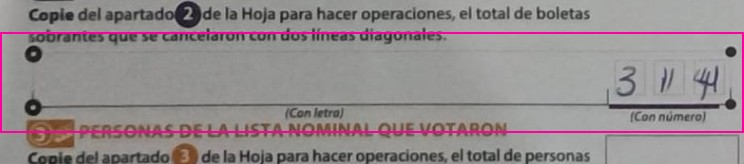
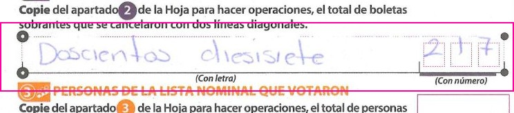
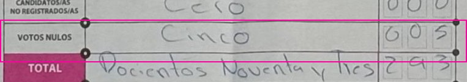

# Adjudication sheet (Amendment 2 b)

Every field where the reader disagrees with the PREP capture. Crops are cut from masked pages only.
Verdict: one of model_right, capture_right, neither, paper_ambiguous, unreadable, crop_wrong. Edit `verdicts.json` (or `adjudication.jsonl`).
`neither` = the paper shows a value that is neither the model's nor the capture's (model wrong, capture also off).
Adjudicator: the AI adjudicator (an AI model, the builder's model, which could see both the model's and the capture's values), from the photo, on the published crops; not blinded; the blind person check is /check?set=confirm100. Every crop is in results/adjudication_confirm100/ for anyone to check.
Vote rows are named Option 01 to Option 15 in printed order (machine files keep INE's column names).

| clave | field | model digits / words | PREP | Computos | form | verdict | paper | evidence (what is written) | crop |
|---|---|---|---|---|---|---|---|---|---|
| 070212B0100 | Unused ballots | 3114 / None | 314 | - | accepted | capture_right | 314 | Digits box: 3 / 1 / 4 (the 1 drawn with a doubled stroke); words line empty. Model read 3114, PREP 314. |  |
| 152285C0100 | Unused ballots | 207 / 217 | 217 | - | routed | capture_right | 217 | Words 'Doscientos diecisiete', digits 2 / 1 / 7. Model digits 207 (its words 217), PREP 217. |  |
| 321493B0100 | Null votes | 5 / 5 | 0 | 4 | accepted | model_right | 5 | Words 'Cinco', digits 0 / 0 / 5. Model 5; PREP 0 is a capture slip; Computos 4 is a recount (Recuento), not this paper. |  |
