# Adjudication sheet, Colima (PROTOCOL.md Amendment 8b)

Disagreements between Gemma and the first capture (PREP) on graded fields that the certified count does not settle. Crops are cut from masked pages only (left of the privacy mask).
Sample: every disagreement on a field some gate accepts (census: these decide the error counts), then a seeded random draw from the rest up to 80 in all: random.Random(20261017).sample(sorted keys, 80 - census); population 414 fields, census 21, random draw 59, not sampled 334 (listed as pending in `pending.json`).
Verdict: model_right, capture_right, neither (the paper shows a third value), paper_ambiguous or unreadable.
Label: **AI adjudicator's reading** (an AI model, the builder's model, on the masked crop; it could see both values; not blinded; never presented as confirmed). Vote rows are named Option 01 to Option 15 in printed order (machine files keep INE's column names).

| clave | field | Gemma | PREP | in | gates accepting | verdict | paper | evidence (what is written) | crop |
|---|---|---|---|---|---|---|---|---|---|
| 060012C0100 | Voters on the list | 390 | 392 | draw | routed | capture_right | 392 | words 'Trescientos noventa y dos', digit boxes 3 9 and a looped 2 | 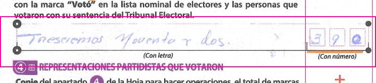 |
| 060024C0100 | Voters on the list | 362 | 302 | census | v1, v3 | paper_ambiguous | None | no words; digit boxes 3, an open 'c' stroke, 2: the middle box reads as 6 or 0 | 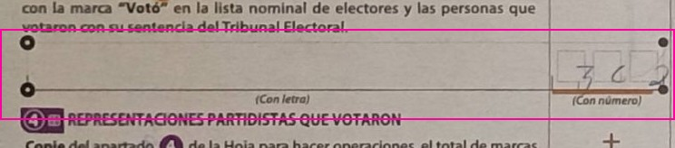 |
| 060024C0200 | Unused ballots | 383 | 382 | census | v1, v2 | paper_ambiguous | None | no words; digit boxes 3 8 and a flat-topped stroke with a curved base that reads as 3 or 2 (the first 3 is written round) | 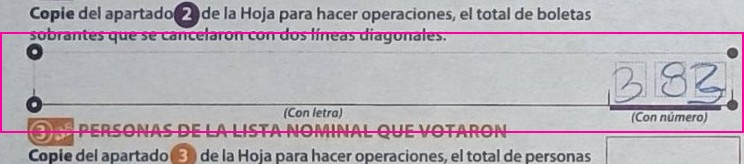 |
| 060031C0100 | Ballots taken from the boxes | 248 | 298 | draw | routed | capture_right | 298 | words 'Doscientos noventa y ocho', digit boxes 2 9 8 | 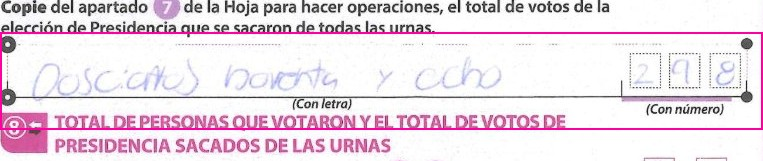 |
| 060036C0100 | Option 12 | 0 | 18 | draw | routed | capture_right | 18 | words 'Dieciocho', digit boxes 0 1 8 | 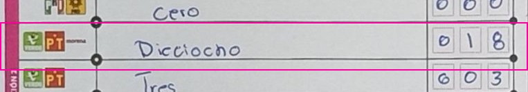 |
| 060058B0100 | Unused ballots | 268 | 208 | census | v1, v2 | capture_right | 208 | words 'Doscientos ocho', digit boxes 2 0 8 |  |
| 060064B0100 | Unused ballots | None | 232 | draw | routed | capture_right | 232 | words 'doscientos treinta y dos', digit boxes 2 3 2 | 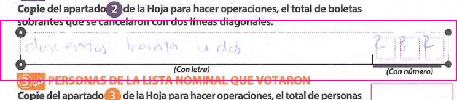 |
| 060066C0100 | Option 15 | 9 | 4 | draw | routed | capture_right | 4 | words 'cuatro', digit boxes 0 0 4 (blurred photo) | 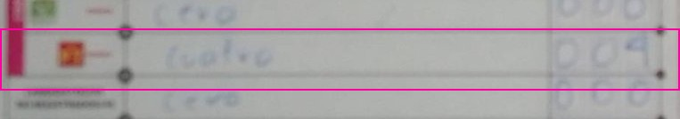 |
| 060067C0100 | Option 12 | 12 | 13 | draw | routed | capture_right | 13 | words read as 'trece', digit boxes 0 1 3 | 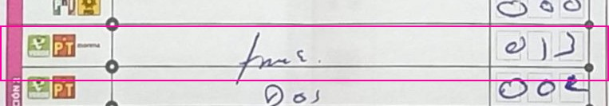 |
| 060073E0103 | Voters on the list | 372 | 373 | draw | routed | capture_right | 373 | words 'trescientos setenta y tres', digit boxes 3 7 and a last box written over; the words give 373 | 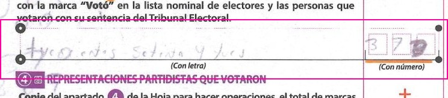 |
| 060085E0200 | Unused ballots | 744 | 144 | draw | routed | capture_right | 144 | words 'Ciento cuarenta y cuatro', digit boxes 1 4 4 | 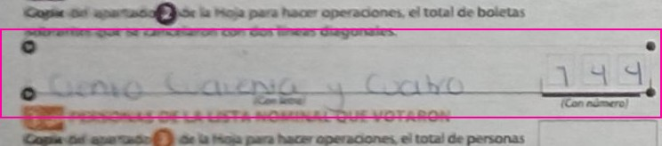 |
| 060085E0300 | Option 01 | 0 | 9 | draw | routed | capture_right | 9 | words 'nueve', digit boxes 0 0 9 | 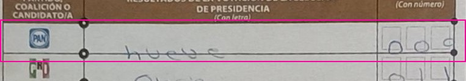 |
| 060093E0100 | Option 01 | 31 | 39 | draw | routed | capture_right | 39 | words 'Treinta y nueve', digit boxes 0 3 9 | 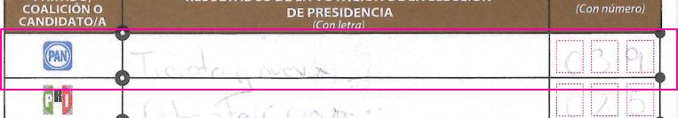 |
| 060093E0100 | Option 10 | None | 0 | draw | routed | capture_right | 0 | words 'Cero', digit boxes 0 0 0 | 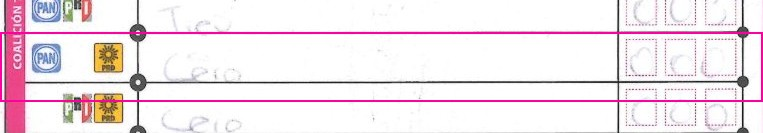 |
| 060093E0100 | Unused ballots | 186 | 143 | draw | routed | capture_right | 143 | no words; digit boxes 1 4 3 | 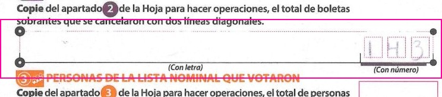 |
| 060094C0100 | Option 08 | 7 | 9 | draw | routed | capture_right | 9 | words 'Nueve', digit boxes 0 0 9 | 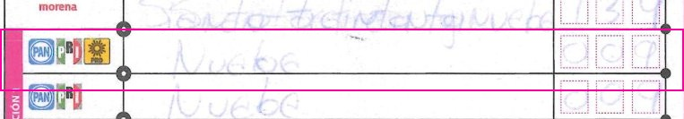 |
| 060099B0100 | Unused ballots | 130 | 131 | draw | routed | capture_right | 131 | no words; digit boxes 1 3 1 |  |
| 060100B0100 | Unused ballots | 22 | 227 | draw | routed | capture_right | 227 | words 'Doscientos veintisiete', digit boxes 2 2 7 | 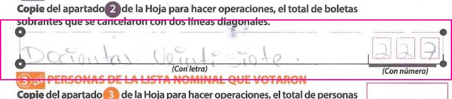 |
| 060100B0100 | Voters on the list | 291 | 341 | draw | routed | capture_right | 341 | words 'Trescientos cuarenta y uno', digit boxes 3 4 1 | 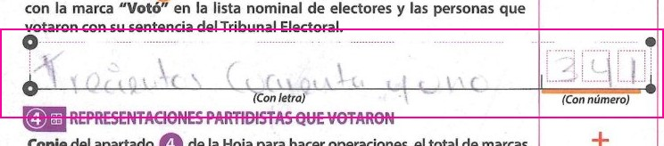 |
| 060111B0100 | Unused ballots | 29 | 291 | census | v1, v2 | capture_right | 291 | no words; digit boxes 2 9 1 | 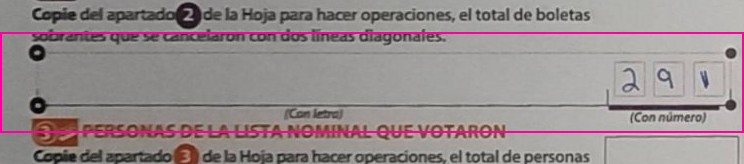 |
| 060138B0100 | Option 01 | 67 | None | draw | routed | neither | 61 | words 'Sesenta y uno', digit boxes 0 6 1 (the capture is blank) | 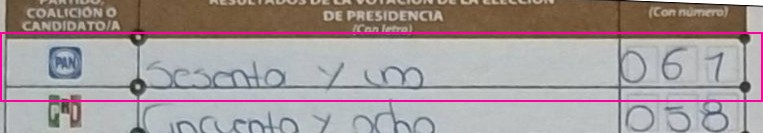 |
| 060139E0203 | Option 10 | 1 | 0 | draw | routed | capture_right | 0 | words 'Cero', digit boxes 0 0 and a short stroke in the last box; the words give 0 | 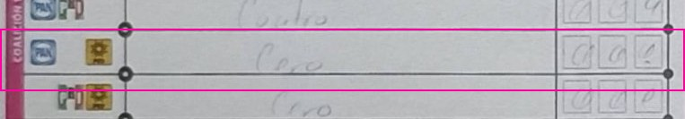 |
| 060151B0100 | Unused ballots | 227 | 229 | census | v1, v2 | capture_right | 229 | words 'Doscientos veintinueve', digit boxes 2 2 9 | 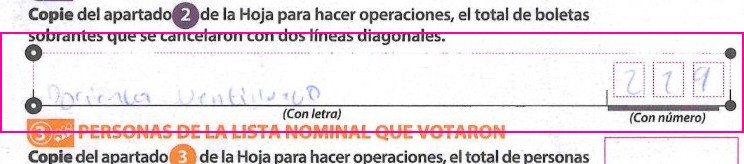 |
| 060156B0100 | Option 12 | 0 | 8 | draw | routed | capture_right | 8 | words 'Ocho', digit boxes 0 0 8 | 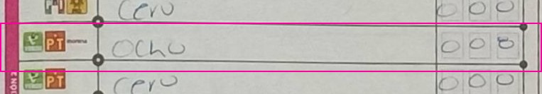 |
| 060158B0100 | Voters on the list | 372 | 362 | census | v1, v2, v3 | model_right | 372 | words 'Trecientos setenta y dos', digit boxes 3 7 2 | 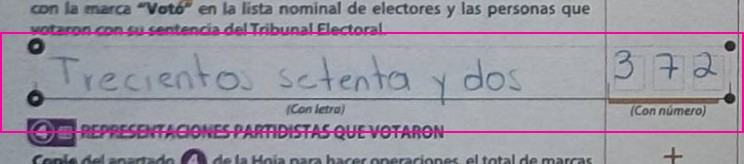 |
| 060178C0100 | Option 10 | 1 | 0 | draw | routed | model_right | 1 | faint page; words 'uno', digit boxes 0 0 1 | 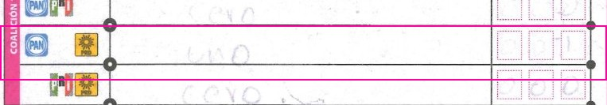 |
| 060178C0100 | Option 11 | 0 | 1 | draw | routed | model_right | 0 | faint page; words 'cero', digit boxes 0 0 0 | 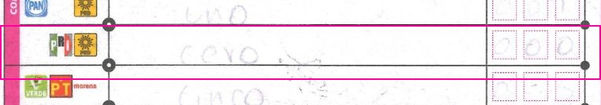 |
| 060178C0100 | Option 14 | 6 | 0 | draw | routed | model_right | 6 | faint page; words 'Seis', digit boxes 0 0 6; the certified count is a recount, not this paper | 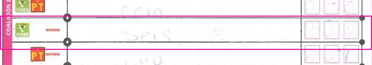 |
| 060178C0100 | Ballots taken from the boxes | 264 | None | draw | routed | paper_ambiguous | None | very faint page; words partly legible ('... sesenta y seis'?), digit boxes not legible | 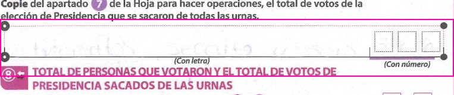 |
| 060178C0100 | Unused ballots | 0 | 308 | draw | routed | capture_right | 308 | very faint page; words read as 'trecientos ocho', only the last digit box legible (8) |  |
| 060178C0100 | Voters on the list | 262 | 382 | draw | routed | neither | 362 | faint page; words 'Trecientos sesenta y dos', digit boxes 3 6 2 | 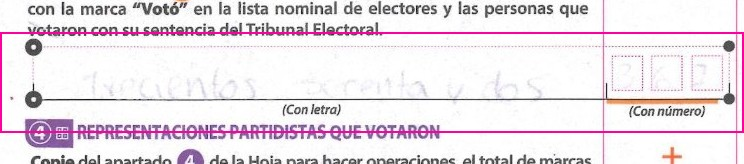 |
| 060179C0100 | Unused ballots | None | 217 | draw | routed | capture_right | 217 | no words; digit boxes 2 1 7 | 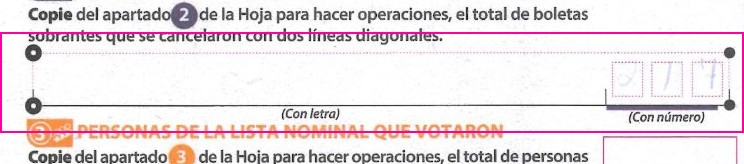 |
| 060182B0100 | Voters on the list | 283 | 287 | draw | routed | model_right | 283 | words 'Docientos ochenta y tres', digit boxes 2 8 and a flat-topped 3 | 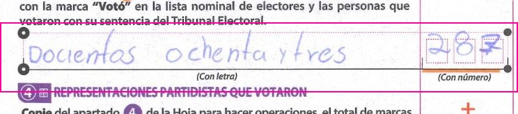 |
| 060193B0100 | TOTAL | 109 | 107 | draw | routed | neither | 104 | words 'Ciento Cuatro', digit boxes 1 0 4; the certified count is a recount, not this paper | 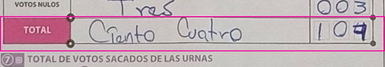 |
| 060202C0300 | Unused ballots | 32 | 321 | draw | routed | capture_right | 321 | no words; digit boxes 3 2 1 | 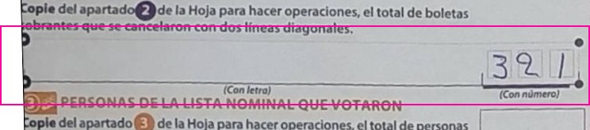 |
| 060204B0100 | Voters on the list | 520 | 320 | draw | routed | capture_right | 320 | no words; digit boxes 3 (flat-topped) 2 0 | 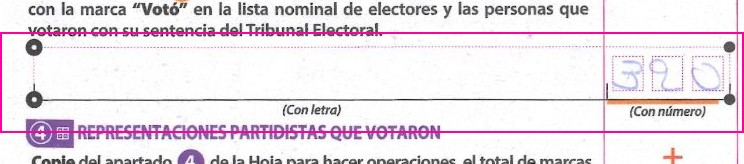 |
| 060210B0100 | Unused ballots | 316 | 310 | census | v1 | model_right | 316 | no words; digit boxes 3 1 6 |  |
| 060214B0100 | Representatives who voted | 12 | 2 | draw | routed | capture_right | 2 | words 'Dos', digit boxes 0 0 2 | 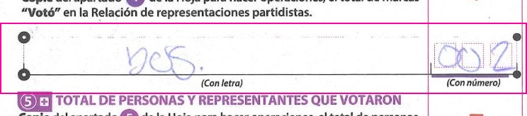 |
| 060214B0100 | Ballots taken from the boxes | 539 | 537 | draw | routed | capture_right | 537 | words 'Quinientos treinta y siete', digit boxes 5 3 7 | 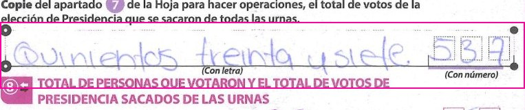 |
| 060221B0100 | Unused ballots | 209 | 214 | draw | routed | capture_right | 214 | no words; digit boxes 2 1 4 | 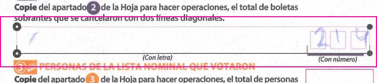 |
| 060223C0100 | Ballots taken from the boxes | None | 251 | draw | routed | capture_right | 251 | words 'Doscientos cincuenta y uno', digit boxes empty | 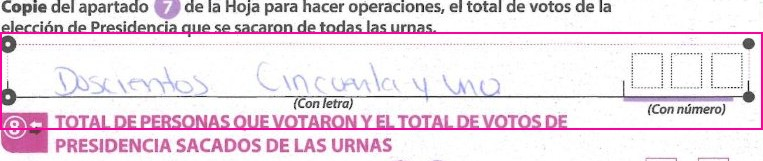 |
| 060233E0100 | Option 01 | 3 | 13 | draw | routed | capture_right | 13 | faint; words 'Trece', digit boxes 1 3 in the last two | 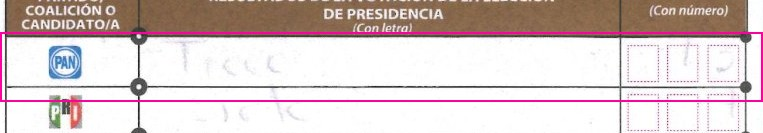 |
| 060233E0100 | Unused ballots | 7 | 237 | draw | routed | capture_right | 237 | words '... treinta y siete', digit boxes 2 3 7 |  |
| 060235B0100 | Unregistered candidates | 3 | 0 | draw | routed | capture_right | 0 | words 'Cero', digit boxes 0 0 0 | 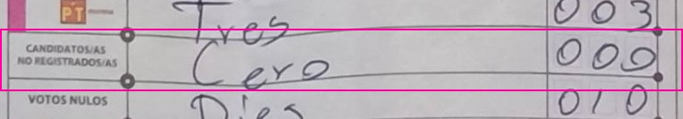 |
| 060235B0100 | Option 15 | 7 | 3 | draw | routed | capture_right | 3 | words 'Tres', digit boxes 0 0 3 | 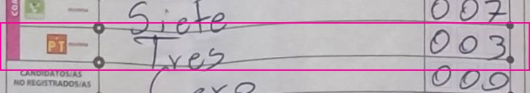 |
| 060239C0100 | Unused ballots | 47 | 247 | census | v1, v2 | capture_right | 247 | words 'Doscientos cuarenta y siete', digit boxes 2 4 7 |  |
| 060242B0100 | Unused ballots | 30 | 307 | census | v1 | capture_right | 307 | no words; digit boxes 3 0 7 | 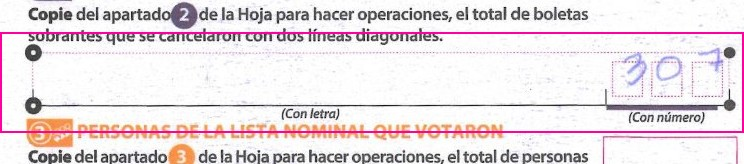 |
| 060243C0100 | Unused ballots | 1612 | None | draw | routed | paper_ambiguous | None | no words; a 1 written left of the three boxes, then 6 1 2 in the boxes: 1612 or 612 | 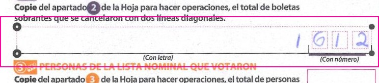 |
| 060246C0300 | TOTAL | 369 | 364 | draw | routed | capture_right | 364 | words 'Trescientos sesenta y cuatro', digit boxes 3 6 4; the certified count is a recount, not this paper | 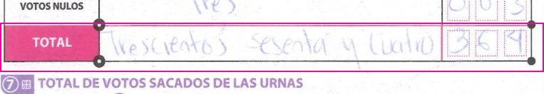 |
| 060248B0100 | Unused ballots | 309 | 305 | census | v1 | model_right | 309 | no words; digit boxes 3 0 9 (the 9 a closed loop with a tail) | 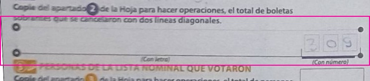 |
| 060248E0203 | Unused ballots | 396 | 346 | draw | routed | capture_right | 346 | no words; digit boxes 3 4 6 |  |
| 060248E0208 | Ballots taken from the boxes | 381 | 384 | census | v1, v3 | capture_right | 384 | no words; digit boxes 3 8 4 (an open-topped 4) | 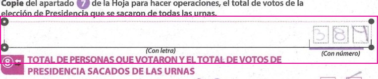 |
| 060248E0208 | Unused ballots | 44 | 344 | census | v1 | capture_right | 344 | no words; digit boxes 3 4 4 |  |
| 060248E0208 | TOTAL | 381 | 384 | census | v1, v3 | capture_right | 384 | no words; digit boxes 3 8 4 (an open-topped 4); the certified count is a recount, not this paper | 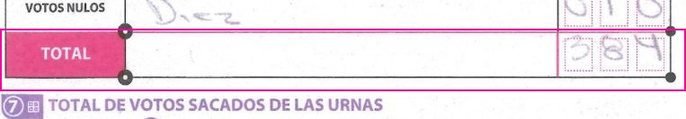 |
| 060251C0200 | Option 03 | 80 | 0 | draw | routed | paper_ambiguous | None | words 'Cero'; digit boxes 0, a pinched loop that reads as 8 or 0, 0 | 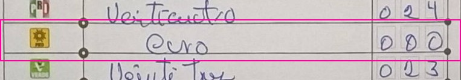 |
| 060251C0200 | Unused ballots | None | 397 | draw | routed | model_right | blank | no words; digit boxes empty | 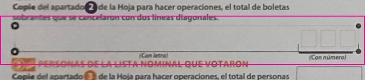 |
| 060252C0100 | Option 12 | 14 | 17 | draw | routed | capture_right | 17 | words 'Diesisiete', digit boxes 0 1 7 | 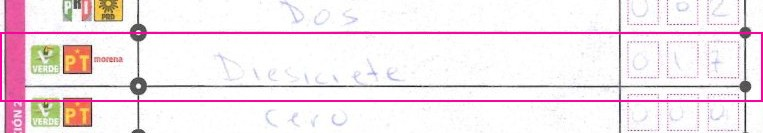 |
| 060252C0100 | Ballots taken from the boxes | 236 | 336 | draw | routed | capture_right | 336 | no words; digit boxes 3 3 6 | 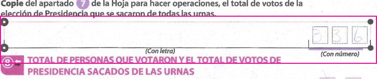 |
| 060252C0200 | Option 03 | 7 | 3 | draw | routed | capture_right | 3 | words 'Tres', digit boxes 0 0 3 |  |
| 060260C0200 | Null votes | 47 | 4 | draw | routed | capture_right | 4 | faint; no words; digit boxes 0 0 4; the certified count is a recount, not this paper |  |
| 060260C0200 | Option 03 | 5 | 3 | draw | routed | capture_right | 3 | faint; no words; digit boxes 0 0 3 |  |
| 060260C0200 | Option 05 | 68 | 8 | draw | routed | capture_right | 8 | faint; no words; digit boxes 0 0 8 |  |
| 060263B0100 | Option 09 | 7 | 1 | draw | routed | capture_right | 1 | words 'Uno', last digit box a 1 with a flag |  |
| 060263B0100 | Option 03 | 7 | 1 | draw | routed | capture_right | 1 | words 'Uno', last digit box a 1 with a flag |  |
| 060264C0100 | Ballots taken from the boxes | None | 309 | draw | routed | model_right | blank | no words; digit boxes empty |  |
| 060264C0200 | Unused ballots | None | 380 | draw | routed | capture_right | 380 | no words; digit boxes 3 8 0 |  |
| 060271C0100 | Option 04 | 95 | 45 | draw | routed | capture_right | 45 | words 'Cuarenta y cinco', digit boxes 0 4 5 |  |
| 060290C0400 | Option 05 | 10 | 16 | census | v1, v2, v3 | capture_right | 16 | words read as 'dieciseis', digit boxes 0 1 6 |  |
| 060290C0400 | Option 13 | 6 | 4 | census | v1, v2, v3 | paper_ambiguous | None | words unclear (possibly 'cuatro'); digit boxes 0 0 and a last box written over (4 and 6 superimposed) |  |
| 060290C0400 | Unused ballots | 369 | 364 | census | v1, v2 | capture_right | 364 | words 'Trescientos sesenta y cuatro', digit boxes 3 6 4 |  |
| 060291C0400 | Option 06 | 36 | 30 | census | v1, v3 | model_right | 36 | words 'treinta y seis', digit boxes 0 3 6 |  |
| 060291C0400 | Unused ballots | 301 | 387 | census | v1 | capture_right | 387 | no words; digit boxes 3 8 7 (a 7 with a crossbar) |  |
| 060358B0100 | Option 07 | 42 | 142 | draw | routed | capture_right | 142 | words 'Ciento cuarenta y dos', digit boxes 1 4 2; the certified count is a recount, not this paper |  |
| 060369C0100 | Ballots taken from the boxes | 294 | 291 | census | v1, v3 | capture_right | 291 | words 'Doscientos noventa y uno', digit boxes 2 9 and a last box written over; the words give 291 |  |
| 060374B0100 | Unused ballots | 79 | 179 | census | v1, v2 | capture_right | 179 | words 'Ciento setenta y nueve', digit boxes 1 7 9 |  |
| 060375B0100 | Option 13 | 1 | None | draw | routed | model_right | 1 | faint; words 'uno', digit boxes 0 0 1 |  |
| 060375B0100 | Voters on the list | 407 | 437 | draw | routed | capture_right | 437 | faint; words '... treinta y siete', digit boxes 4 3 7 |  |
| 060396B0100 | Voters on the list | 374 | None | draw | routed | paper_ambiguous | None | no words; digit boxes written over several times (3, 7, then 8 or 4), with other figures above the field |  |
| 060398B0100 | Option 15 | 1 | 2 | draw | routed | capture_right | 2 | words 'Dos', digit boxes 0 0 and a 2 written over a 1 |  |
| 060399C0200 | Unused ballots | 338 | None | census | v1, v2 | model_right | 338 | words 'Trecientos treinta y ocho', digit boxes 3 3 8 |  |
