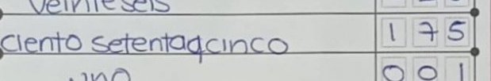

<!-- _class: title -->

# Two Hands: receipts for every number keyed from paper

Two hands: two independent readers, and the paper's own arithmetic as the referee.

A second keyer that shows its proof. An open vision model, **Gemma on AMD**, re-reads every field of forms already keyed; the paper's arithmetic decides what is accepted; a person sees every disputed field with its photo.

Measured on a pre-registered random 300 of Mexico's 2024 handwritten tally sheets. An independent demonstration of clerical capture quality, not an official INE product.

---

## One receipt

The paper

175

words "ciento setenta y cinco" = one hundred seventy-five · boxes 1 7 5

The first capture keyed

75

one of 52 fields where the capture does not match the paper

The certified count

175

settled by comparison with the paper ("Cotejo")

Form 050815B0100, Option 07, from the pre-registered random 300 (masked crop). Sources: app/data/headline.json ("receipt"); INE PREP 2024 and Cómputos Distritales 2024, free-use terms. Each receipt is Merkle-anchored: "verify this receipt" in the app.

<!--
The video opens on this card. The model read 175 from both the words and the boxes; the first capture keyed 75; the certified count says 175.
-->

---

## The problem, from INE's own files

6.5%

of the 52,167 polling stations that were not recounted: INE's two official captures of the same paper disagree on at least one vote field (3,382).

19.2%

of fully captured national forms fail their own row sum in the official capture (26,336 of 137,196).

software, not values

The mandated outside audit of each PREP, by rule, checks the software, not the keyed values against the paper.

A difference says two captures disagree, not which one is right; the photo does.

The preliminary count is preliminary by design; the certified count is the official result.

Sources: results/national_counts.md (PREP 2024 CSV; Cómputos Distritales 2024 CSV); audit scope: Reglamento de Elecciones art. 347.1 and INE's 2024 PREP audit report (UAM-I), PDF p. 7. Clerical only: no party, no totals, no outcome.

<!--
Full line, as computed (app/buyer.py): On the 52,167 polling stations that were not recounted, INE's two official records of the same paper, the preliminary capture and the certified count, disagree on at least one vote field in 3,382 (6.5%). A difference says two captures disagree, not which one is right; the photo does. On our 300, the photo sided with the certified count on 22 of the 31 it covered.
-->

---

## How it works: two hands and a referee

Hand 1

<strong>Gemma-4-31B-IT on AMD</strong> reads every field twice, the handwritten digits and the amount in words, plus each row's printed label.

Hand 2

<strong>A second, independent reader</strong> (Qwen3.8-27B on AMD) must agree field by field. It never overrides Gemma; it only withholds acceptance.

The referee

<strong>The paper's arithmetic:</strong> words = digits, rows sum to TOTAL, sections agree, every row label where it belongs.

<strong>The gate.</strong> Every identity holds: accepted. Any fails: the form is routed, with the failing field named. It never guesses a value.

<strong>A person sees the rest:</strong> the field, both reads and the crop. One value typed; the identities re-check at once. Names column masked before anything is stored or sent.

A form type is one schema file. Pipeline: locate the page and mask it (CPU) → one request per form on AMD Token Factory → gate (plain Python). docs/ARCHITECTURE.md.

---

## Measured, not promised

52

fields where the official capture does not match the paper, each with its photo; <strong>22</strong> confirmed by the certified count, 30 judged from the photo by the AI adjudicator

One reader (primary)

18%

of forms accepted with no person: 2 wrong of 1,210 fields

Two readers (secondary)

30%

0 wrong of 1,958 fields (lighter gate; full gate: 7%, 0 of 484)

Confirmation, 100 fresh forms

0 / 484

accepted fields wrong; the 95% upper bound (0.79%) is above the pre-registered 0.5% bar, so the bar is met on the point estimate only

<strong>Alone, one model mis-keys 1 field in 37. Behind the gate, 1 in 605 accepted fields is wrong.</strong>

Pre-registered random 300 (protocol a93294c, Amendments 1-3, committed before any model read); Gemma-4-31B-IT read 289. The 30% tier is a secondary analysis, defined (Amendment 2) after the one-reader result was seen and before the second reader ran; it uses the lighter gate (no section checks). Wrong = against the official capture; every disagreement checked on the photo; agreeing fields not individually checked. Confirmation: gate v2, seed 20261017, results/confirm100.md (truth: AI adjudicator on published crops, labelled). app/data/headline.json; results/two_reader_300.md.

<!--
As computed (app/numbers.py lines(), word for word): 17 wrong numbers typed; 27 readable fields recorded as illegible, 23 of them on two faint pencil forms; 6 numbers typed where the paper is blank; 2 other. Each with its photo. One reader: 18% of forms accepted at second capture, 2 wrong fields in 1,210. Two readers that must agree, with the paper's sums as referee: 30%, 0 wrong in 1,958 (secondary, lighter gate; with the full gate, 7%, 0 wrong in 484). The one-reader figure is the pre-registered primary. The 30% tier is a secondary analysis, defined (Amendment 2) after the one-reader result was seen and before the second reader ran; it uses the lighter gate (no section checks). Wrong is judged against the official capture; every disagreement checked on the photo; fields where the model and the capture agree were not individually checked. Alone, one model mis-keys 1 field in 37. Two models that agree, refereed by the paper, mis-keyed 0 of 1,958 accepted fields against the official capture. 1 in 5 disputed fields is a confirmed capture error (52 of 267). The capture's overall error rate is at least 1 in 122 (52 of 6,358 found so far). Of the 52: 22 confirmed by the certified count, 30 judged from the photo by the AI adjudicator (the builder's model, which could see both values). Recall is unmeasured, so the multiple between the two rates is too.
-->

---

## Institutes already tried to buy machine reading

- INE put MXN 9.5M in its 2024 draft budget for an automated first capture service (PTO numeral 30), a different step from our check, and bought none (last line). (p. 4)
- IPN quoted MXN 19.9M for the service. (p. 4)
- The acceptance bar was 80% agreement on words and digits. (p. 5)
- The best entrant reached 75%; INE declined it as untested in a real election, and its advisers (COTAPREP) recommended a pilot. (pp. 5, 10)

**Our engine is an automated capture with a referee. For 2027 we offer an independent check of a finished capture, which needs no rule change; the capture inside the loop is the pilot COTAPREP requested, offered as a pilot on 2024's own forms.**

83.5%

On that metric as we read it, Gemma's existing reads of our pre-registered 300 agree with the official capture in words and digits on 83.5% of fields (5,508 of 6,600; failed reads and blank or illegible captures count against us).

<i>INE's 2024 acceptance metric as we read it from the report, computed on our existing reads after they were made; the definition was committed before computation; not the same test set or conditions as INE's trial.</i>

Beside it, the result that decides acceptance: 0 wrong of 1,958 accepted fields (two readers, the paper's sums as referee), judged against the official capture; every disagreement checked on the photo; fields where the model and the capture agree were not individually checked.

Source: INE, PREP PEF 2023-2024, "Captura Automática" report, CCOE 10th session 26-08-2024 (repositoriodocumental.ine.mx, ccoe-10se-26-08-2024-p17-1.pdf). Metric: results/ine_metric_DEFINITION.md (committed before computation), results/ine_metric.md. Buyer, 2027: the outside auditor or the contracted PREP operator, for an independent check of a finished capture; no rule change needed (docs/BUSINESS.md).

<!--
Who pays, in order (app/buyer.py, word for word): Who pays in 2027: the PREP's outside auditor or its contracted operator, for an independent check of a finished capture, field by field against the photo. It needs no rule change: it is an outside check, which is what we measured. A model as the regulated second capture (PTO numeral 33) needs the institute's governing body to approve it after INE's opinion (RE art. 339); that is the longer-term path, not the 2027 product. Which form: state institutes (OPLEs) process local actas (governor, local deputies, municipalities). The presidential forms we measured (and the Senate forms we read) are federal, processed by INE. Our local evidence is the Baja California Sur head-to-head on local actas (PROTOCOL_IEEBCS.md): read on AMD, not yet scored: no result is shown until it is. Status: no buyer contacted yet.
How big, as arithmetic (ESTIMATE, not counted): about 170,000 federal actas (169,005 presidential sheets in 2024, one per polling station) plus the local actas of the 32 local processes, two to three per polling station where a state elects two or three local offices (Morelos 2024: 7,802 local actas for three offices), so roughly 500,000 to 700,000 actas in a concurrent year; at $1 per acta, under $1M per three-year cycle at list price. Mexico's PREPs are the beachhead; the same field-level check applies wherever keyed values must match paper.

1. Morelos paid MXN 26.6M for its 2024 PREP: 7,802 actas expected, 110 capture-and-verification posts, and an MXN 1.5M outside audit of the system, which by rule checks the software, not the keyed values against the paper. We check every value for $1 per acta, about 9.5% of Morelos's audit line and 0.5% of its PREP cost per acta (MXN 3,409, ~$185).
2. Baja California Sur bought an AI first capture by direct award (Google Document AI, MXN 93,834.49); it matched the human capture on 2.88% of actas and 62.84% of fields. A machine already keys; the question is who referees it.
3. Every state institute decides whether to run its PREP alone or with a third party at least six months before election day: for 6 June 2027, by about 6 December 2026. Guerrero has already decided: in-house, "con acompañamiento de un ente especializado".
4. The 2027 buyer is the outside auditor or the contracted PREP operator, paid by the state institute (OPLE). At least 13 of the 17 outsourced 2024 state PREPs went to three firms: Informática Electoral S.C. (at least 8 states), Grupo Proisi (4) and PoderNet (1).
-->

---

## Price and unit economics

Line 1 (proposal)

$1

$1 per form audited (second capture + cotejo + receipts)

Line 2

<strong>$5 per confirmed capture error, $0 if none is found</strong>

**Costs per form.** AMD compute $0.00014 per form (measured) · review labour for routed fields about $0.09 to $0.13 per form (GUESS: 20 s per disputed crop) · hosting and sales, not measured.

**Anchor.** INE's own line was MXN 9.5M for ~170,000 actas, about MXN 56 (~$3) per acta for a first capture alone.

**Per state.**
- Morelos, 7,802 forms: about $7,800 (MXN 143k), under the lowest federal direct-award ceiling
- the largest state (Estado de México), 20,908 forms: about $20,900 (MXN 384k), over the lowest federal direct-award ceiling, under the highest
- the federal count, 169,005 forms: about $169,000 (MXN 3.1M), over every federal direct-award ceiling: a tender; INE's own line was MXN 9.5M

Line 2 basis: 52 confirmed capture errors in 267 disputed fields on 289 read forms, $1 / 0.180 = $5.56, rounded down. Review: 0.92 crops per form measured, $18 to $25 an hour. FX: MXN 18.3835 per USD (ECB, 2026-10-16). Ceilings: PEF 2026 Anexo 9. One config: app/pricing.py; docs/BUSINESS.md.

---

## Gemma on AMD

**Gemma-4-31B-IT is in both zero-error two-reader pairs (0 wrong of 1,958 accepted fields with Qwen3.8-27B; 0 wrong of 924 accepted fields with Qwen3.8-Flash-Next); the only pair without Gemma made errors (2 of 814).** Every form of the 300, on AMD GPUs via AMD Token Factory: one request per form (page + 6 zoomed tiles).

All 169,005 national forms

~$24

of AMD compute ($0.000144 per form, measured)

Server time per form

83 s

HTTP round trip on the shared endpoint; 87 s wall clock includes our own pacing

Tokens per form

2,609 / 804

in / out; 289 of 289 replies end in stop

<strong>Open-model bake-off, same forms, prompt and gate:</strong> Gemma-4-31B-IT is the per-dollar leader and accepts the most forms; Qwen3.8-Flash-Next agrees most with the capture, at about fifteen times the price.

| Open model on AMD Token Factory | Gemma-4-31B-IT | Qwen3.8-27B | Qwen3.8-Flash-Next |
|---|---|---|---|
| Forms accepted, no person | **55 of 300** | 31 of 300 | 17 of 128 |
| Cost per 1,000 forms | **$0.14** | $0.64 | $2.11 |
| Time per form (Gemma, Qwen-27B: wall clock; Flash-Next: server) | **87 s** | 241 s | 120 s |

results/bakeoff_300.md (Amendment 6), results/gemma_vs_qwen.md, results/calls_gemma.jsonl; docs/GEMMA.md. Gemma was unavailable on Token Factory from 2026-10-15 15:41 to 2026-10-16 02:06 UTC (endpoint log); every measured read of the 300 is Gemma on AMD. Server time and cost: results/amd_benchmark.md.

<!--
Gemma-4-31B-IT is in both zero-error two-reader pairs (0 wrong of 1,958 accepted fields with Qwen3.8-27B; 0 wrong of 924 accepted fields with Qwen3.8-Flash-Next); the only pair without Gemma made errors (2 of 814). Gemma-4-31B-IT is the primary reader in every mode: it reads every form, accepts the most forms alone (55 against Qwen's 31), and costs a quarter of the second reader. In two-reader mode a second model must agree with Gemma field by field before the paper's arithmetic accepts; the second reader never overrides Gemma, it only withholds acceptance.
-->

---

## Evolus: where the case lives

**Workspace py_tr** (event code AMDACT3).

- **Agent "Intake clerk"** on Gemma-4-31B-IT, AMD Token Factory: drafts each finding "for the auditor to confirm". It never decides.
- **Workflows:** "Audit finding" (the live audit opens a case per strong-evidence dispute, at most 60 a day), "Review hand-off", "Record filing".
- **AI Tool** `translate`: every review task in English and Spanish. **Scripts** re-check the paper's identities with no AI.

Requirement 2, confirmed

"Token Factory works fine on Evolus and does count for the Track."

The Evolus team, Discord, 2026-10-16

The decision stays with the paper's arithmetic, never with a model; Evolus records each run as a workflow audit.

docs/EVOLUS.md; evolus/ (built and driven over the Evolus REST API, docs/evolus-openapi.json). Workspace and model endpoint stay online until Nov 15, 2026 for the Evolus review.

---

## The next markets, not measured

<!-- Slide 10b: volume -->

<strong>Why elections.</strong> Most paper records are private, by law or by contract: patient charts, loan files, drug registers, so nobody can publish an error rate on them. Mexico's tally sheets are the clearest exception: the photo, the keyed value and the certified count are all public. That's why we measured there. <strong>Elections are our proof set, not our only market.</strong>

1. **Health facility reports (DHIS2):** WHO's Data Quality Review recounts paper source documents against what was keyed; DHIS2 runs in 80+ countries; monthly forms carry their own totals.
2. **US mortgage post-closing QC:** lenders re-check at least 10% of closed loans against source documents every month; 4.4 million closed-end originations in 2023.
3. **Clinical-trial source data verification:** it corrects 1.1% of site data while monitoring takes 15-30% of trial costs.
4. **Peru:** ONPE's 2026 rule keys every acta twice, one of them by a virtual assistant; not measured by us.

<strong>The referee is arithmetic, and arithmetic has no language. Measured on Spanish handwriting and English ledgers; the only language-specific check is words against digits, and the reader is a multilingual model.</strong>

No second-language corpus with an official keyed record and usable terms was reachable; the language claim stays at what was measured.

Sources: WHO DQR Module 3 (2020); dhis2.org/about; Kenya MOH 711A; Fannie Mae Selling Guide D1-3-01, D1-3-02; CFPB HMDA 2023; Lindblad et al., Clinical Trials 2014; ONPE RJ 000093-2026 (El Peruano, 6 Jun 2026). Links: docs/BUSINESS.md.

<!--
Word for word (app/buyer.py):
Health facility monthly reports (HMIS / DHIS2): WHO's Data Quality Review recounts the paper source documents against what was keyed into the national database, and DHIS2 is the national health data system in 80+ low- and middle-income countries; the monthly forms carry their own totals (Kenya MOH 711A: new + re-visits = total).
US mortgage post-closing QC: Fannie Mae's Selling Guide makes lenders re-check at least 10% of the loans they close (or a statistical sample) every month, plus targeted selections, against the source documents; 4.4 million closed-end originations in 2023.
Clinical-trial source data verification: a 7,000-trial analysis found it corrects 1.1% of site-entered data, while monitoring and verification take 15-30% of trial costs; pointing the monitor at the fields the paper disputes is the mechanism we measured on election forms.
Peru: ONPE's 2026 rule keys every acta twice, one of them by a virtual assistant ("una de ellas, por un asistente virtual"); same process, second country, by regulation; not measured by us.
-->

---

## Limits and the failure case

- **SOBRANTES (unused ballots)** is the one graded field in no identity printed on the form: every accepted-field error on the 300 was SOBRANTES. Gate v3 (pre-registered) accepts it only when two independent reads agree; otherwise a person sees it.
- **Digit insertion:** on 070212B0100 the model read 3114 where the paper says 314; the frozen gate accepted it, gate v2 did not.
- **Harmonised reads:** in one call the model can make words and digits agree (010469C0400: words and digits 239, paper 234). One read is not two independent reads; the fix is a second reader.
- **Label-gate false alarms:** the row-label check routed 86 forms; 68 of them were read right on every field.
- **Failure case:** a rainfall ledger read as one image shifted a row one year; sums still held, 26 of 870 accepted cells wrong. Tiles and the row-label check removed it.

<strong>Safeguard:</strong> accept only when every identity holds; everything else goes to a person with the field named. Fail closed when the page cannot be located (11 of 300).

app/data/headline.json ("harmonised", "label_gate"); results/confirm100.md; results/bakeoff_300.md ("Wrong accepted fields"); README "Limits and failure cases"; docs/EVALUATION.md.

---

<!-- _class: title -->

# Receipts for every number keyed from paper.

A second keyer that shows its proof: two independent readers on AMD, and the paper's own arithmetic as the referee. Every disputed field goes to a person with its photo.

**Live demo:** add at submission · **Video:** add at submission · **Repo:** add at submission

Reproduce every number offline: <code>make eval</code>. Gemma-4-31B-IT on AMD Token Factory · Evolus workspace py_tr. Vote rows shown as Option 01 to 15; no party is named or compared.

