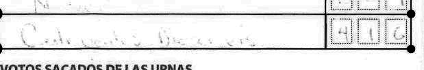
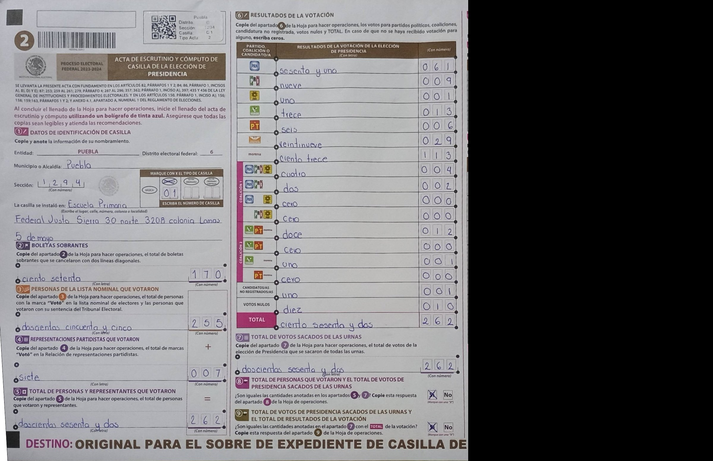

<!-- Slide 1: the one sentence -->

# Two Hands

## Receipts for every number keyed from paper

Two hands: two independent readers, and the paper's own arithmetic as the referee.

A second keyer that shows its proof. An open vision model on AMD GPUs re-reads every field of forms already keyed. The form's own arithmetic decides what is accepted; every disputed field goes to a person with its photo.

Demo, video and repo links: on the submission page.

---

<!-- Slide 1b: the receipt (the video's first 10 s) -->

## One receipt

Form 050815B0100, Option 07. **The first capture keyed 75. The paper says 175. The certified count says 175.**

In English: words "ciento setenta y cinco" = 175 · boxes: 1 7 5. Confirmation: certified count, by comparison (INE Computos, "Cotejo").

Second card, 070207C0100 TOTAL (faint pencil, *enhanced for display*): the capture recorded it as illegible; the model read 416; the certified count, after a recount, says 416. Words "Cuatrocientos dieciseis" = 416 · boxes: 4 1 6.

Both from the pre-registered random 300, two of the 52 fields where the capture does not match the paper. Masked crops; INE PREP 2024, free-use terms; not an official INE product. Each card's Merkle receipt: "verify this receipt" on the app's Home card.

---

<!-- Slide 2: the problem -->

## Today every form is typed twice

Organisations key paper forms twice, because one keyer's mistakes cannot be found any other way. Mexico's 2024 national capture programme did this for every tally sheet.

Double keying copies the paper faithfully. It cannot say which paper is wrong: **19.2%** of nationally captured tally forms (26,336 of 137,196) fail their own row sum.

Source: PREP 2024 CSV. See docs/NUMBERS.md.

---

<!-- Slide 3: how it works -->

## Many forms check themselves

**1. Mask**
Locate the page. Black out the names-and-signatures column before anything is stored or sent.

**2. Read on AMD**
Gemma-4-31B-IT reads every field twice: digits and words. Plus the printed label of each row.

**3. Gate**
Words = digits. Rows sum to TOTAL. Sections agree. All pass: accepted. Any fail: a person sees the field.

A form type is one schema file. A new form is configuration, not code.

---

<!-- Slide 4: a routed form -->

## A routed form names its failing field

Form 211294C0100. The TOTAL digits say **262**. The words say **162**. The rows sum to 262.

The gate does not guess. It sends this one field to a person.

Masked page. INE PREP 2024, free-use terms. Not an official INE product.

---

<!-- Slide 5: headline numbers -->

## Results: a pre-registered random 300

52
fields where the official capture does not match the paper 17 wrong numbers typed; 27 readable fields recorded as illegible, 23 of them on two faint pencil forms; 6 numbers typed where the paper is blank; 2 other. Each with its photo.

One reader: 18% of forms with no person, 2 wrong fields in 1,210. Two readers that must agree, with the paper's sums as referee: 30%, 0 wrong in 1,958. Both pre-registered; the one-reader figure is the primary. Note: the two-reader tier checks words = digits and row sums, without the section checks.

1 in 5
disputed fields is a confirmed capture error (52 of 267) the capture's overall error rate is at least 1 in 122 (52 of 6,358 found so far); more than ten times the yield of a random check

**Alone, one model mis-keys 1 field in 37. Two models that agree, refereed by the paper, mis-keyed 0 of 1,958.**

One reader: about 1 in 605 accepted fields wrong. Gemma-4-31B-IT on AMD. Protocol committed (a93294c, Amendment 1 b0e443c) before any model read. The first capture is preliminary by design; the certified count is the official result. Recall: on forms the certified count settled by comparison, 16 of its 23 differences from the first capture are council corrections or blank rows; the model disputed all 7 others (small n).

---

<!-- Slide 6: audit mode -->

## Audit mode: one capture error

Form 050815B0100, Option 07. **The paper says 175, the first capture keyed 75, the certified count says 175.**

The 52: 17 wrong numbers typed; 27 readable fields recorded as illegible, 23 of them on two faint pencil forms; 6 numbers typed where the paper is blank; 2 other. Each with its photo. On 250767B0100 the capture shifted a whole column by one row.

Masked crop. INE PREP 2024, free-use terms. Not an official INE product. Rows are Option 01 to 15; no party is named or compared.

---

<!-- Slide 7: safeguard -->

## A person sees everything the paper cannot settle

The review desk shows only the failing field, the model's digits and words, and the crop. A person types one value. The identities re-check at once.

If the paper contradicts itself, the person escalates it. Nothing is corrected silently. A page that cannot be located is never sent.

---

<!-- Slide 8: AMD -->

## What ran on AMD

| | Gemma-4-31B-IT | Qwen3.8-27B |
|---|---|---|
| Role | primary reader | second reader |
| Mean latency per form | 87 s (300 run) | 85 s (pilot) |
| Tokens in / out | ~2,609 / 804 | ~8,739 / 1,667 |
| Cost per form | $0.000144 | $0.000507 |

Gemma-4-31B-IT is the primary reader in every mode: it reads every form, accepts the most forms alone (55 against Qwen's 31), and costs a quarter of the second reader. In two-reader mode a second model must agree with Gemma field by field before the paper's arithmetic accepts; the second reader never overrides Gemma, it only withholds acceptance.

AMD Token Factory, the organisers' hosted AMD GPUs. One request per form. ~2 forms/min under our shared-key pacing.

Gemma: means over the 289 reads of the pre-registered run. Qwen: pilot, 43 forms. Locating, masking and the gate run on CPU.

---

<!-- Slide 8b: Gemma on AMD -->

## Gemma on AMD: what it took

Gemma-4-31B-IT reads every value twice, the **handwritten digits** and the **amount in Spanish words**, plus the printed label of each row. Phone photos, faint pencil.

- **Fixed ~263 image tokens per image**, whatever the resolution. So: page + 6 zoomed tiles in one request. Ledgers: **79% → 97%** cells right once tiled.
- **Frozen prompt** (sha256 `3664253035b9…`), rows not named: Gemma reports each row's label, a shifted row is caught.
- **Junk after the answer:** first complete JSON parsed, `max_tokens` 2000, `length` never accepted. 289/289 `stop`.

| Same 300 forms, same prompt and gate | Gemma | Qwen3.8-27B |
|---|---|---|
| Accepted, no person | **55** | 31 |
| Accepted fields wrong | 2 of 1,210 | 1 of 682 |
| Cost per form | **$0.000144** | $0.000597 |
| Mean latency | **87 s** | 241 s |

results/gemma_vs_qwen.md (scripts/gemma_vs_qwen.py; both passes complete). Gemma was withdrawn from AMD Token Factory on 2026-10-15 ~15:41 UTC; live reads now fall back to Qwen on AMD. Every measured read of the 300 run is Gemma on AMD GPUs. docs/GEMMA.md.

---

<!-- Slide 9: second form type -->

## A second form, a different century

UK rainfall ledgers, 1850 to 1960. Twelve months must add up to the clerk's annual total.

**Spike, 40 sheets, 4,915 cells.** 306 of 380 year-columns accepted. **3,976 of 3,976** accepted cells (spike, 40 sheets) match the 16,000 volunteers.

Rainfall Rescue, Hawkins et al. 2022. Images linked, not redistributed.

---

<!-- Slide 9b: the regulated process, 1:1 -->

## The rule already asks for a second capture

| INE's PREP process (PTO 2023-2024) | Two Hands |
|---|---|
| Digitalización (num. 4 c, 23-28) | the same image; page located, names column masked |
| First capture, automatic or human (30-32) | taken as given |
| **Second capture by a person (33)** | **the model reads every field: digits, words, row label** |
| **Comparison: all equal, done (33)** | **field by field; agreement + the paper's sums accept** |
| Third capture on mismatch (34) | only the disputed fields, ordered by evidence |
| Centro de Verificación (35) | gets what the paper itself does not settle |
| Cotejo: published data vs the acta (4 f, 45) | a crop and a mark for every disputed field, CSV |

On INE's published 2024 capture, after all of the above: **0.8% of fields still do not match the paper** (52 of 6,358, at least); our second capture puts **1 in 5** of its disputes on a confirmed capture error.

**$100 per 1,000 forms** (proposal) · measured AMD compute **$0.14 per 1,000** (Gemma), $0.65 with the second reader.

PTO: repositoriodocumental.ine.mx, CGex202311-03-ap-8-a.pdf. All 32 state PREPs: Reglamento de Elecciones art. 339.1 d, Anexo 13 numerals 15 and 21. Numeral 33 names a person: a model as the second capture is a change the institute must approve. We show evidence, not compliance. Measured: app/data/headline.json, results/calls_gemma.jsonl.

---

<!-- Slide 10: market and model -->

## Market and model: who pays for the second capture

**Now.** PREP operators and vendors, who pay the capturistas for the second capture, and the 32 state institutes (OPLEs) that contract them and approve the process (Reglamento de Elecciones art. 339.1 d, art. 346.1 "desarrollado por terceros"). Next window: 32 concurrent local processes, election day **6 June 2027**. **Secondary:** the outside auditors (art. 347; in 2024, 26 of 32 named, all universities or research centres), for an audit of a finished capture.

**Next market, not measured.** Clinical-trial source-data verification (site monitoring and source document verification: 15-30% of trial costs); insurance claims; customs declarations.

| Yield (measured) | Cost (measured) | Price (proposal) |
|---|---|---|
| **About 5 fields looked at per confirmed capture error, vs about 122 at random.** 267 disputed fields found 52; 267 random fields would find about 2. Strong tier: 12 of 18 | $0.14 per 1,000 forms (Gemma) + $0.51 (Qwen, pilot) on AMD | **$100 per 1,000 forms audited**, report included. One state: 1,017 to 20,908 sheets, **about $100 to $2,100** |

Small enough to buy without a tender: the lowest federal direct-award ceiling is MXN 309,000 per operation (PEF 2026, Anexo 9). State institutes buy under state rules, not checked one by one.

Sources: INE annex 5, CCOE 23-02-2024; IEEH/CG/022/2024; INE Central Electoral 30-31 July 2026; PEF 2026 (DOF); PREP 2024 CSV; Lindblad et al., Clinical Trials 2014. Full case: docs/BUSINESS.md.

---

<!-- Slide 10a: unit economics -->

## Unit economics, per 1,000 forms

$100
proposed price per 1,000 forms audited, two readers and the report included

$0.65
measured AMD compute per 1,000 forms: $0.14 Gemma-4-31B-IT (289 reads of the 300) + $0.51 Qwen3.8-27B (43 pilot reads)

&lt; 1%
compute is under 1% of the price (0.65%)

The price also covers review labour for routed fields, hosting and sales; compute is the smallest part.

Measured: results/calls_gemma.jsonl (mean $0.000144 per form), docs/NUMBERS.md A2 (Qwen, $0.000507 per form). Price: proposal. docs/BUSINESS.md, "Unit economics".

---

<!-- Slide 10a2: the second business line -->

## When an agent keys a form, the paper still has to agree

Receipts work the same for a model as for a person; in our measurement, Gemma is the agent.

Gemma-4-31B-IT keyed every field of the 289 read forms; alone it mis-keys 1 field in 37, and the same paper arithmetic that catches a person's slip catches the model's. A second line, not the hero: the buyer is anyone who lets an agent fill a form from paper.

Measured: results/adjudication/SUMMARY.md (173 of 6,358 fields). Next market, not measured.

---

<!-- Slide 10b: volume -->

## One result sheet per polling station, every election

**The referee is arithmetic, and arithmetic has no language. Measured on Spanish handwriting and English ledgers; the only language-specific check is words against digits, and the reader is a multilingual model.**

No second-language corpus with an official keyed record and usable terms was reachable; the language claim stays at what was measured.

Forms of this kind, with rows that sum to a total and often words beside digits, are produced at these volumes every cycle.

| General election | Result sheets (polling stations) |
|---|---|
| Mexico 2024, presidential | 169,005 |
| Nigeria 2023 | 176,846 polling units |
| Kenya 2022, presidential | 46,229 Form 34A |
| India 2024, Lok Sabha | 1,052,664 |
| Indonesia 2024 | 820,161 domestic TPS |

**A live problem.** Indonesia's 2024 count app read photographed result sheets by machine; a KPU commissioner attributed input errors partly to the system misreading digits ("a 3 read as an 8"). Result-sheet capture errors are the thing we check. Volume only; we have measured Mexico alone.

Sources: PREP 2024 CSV; INEC Polling Units page; IEBC press release 17-08-2022; PIB/ECI data release; KPU RI voter-roll recap (July 2023); Antara 15 and 19 Feb 2024. Links: docs/BUSINESS.md.

---

<!-- Slide 11: competition -->

## Competition: others extract, we audit

| | Handwriting | Proves each accepted value | Audits an existing capture | Photo per finding | Open model on AMD |
|---|---|---|---|---|---|
| **Two Hands** | yes (measured) | the paper's identities | **yes** | yes | yes |
| Tesseract | "won't work very well" | no | no | no | open, CPU |
| ABBYY, Rossum, UiPath, Document AI | yes (vendor pages) | unknown | not a stated feature | unknown | no |
| AWS Textract | English only | confidence score | not a stated feature | no | no |
| Sampling audit (status quo) | a person | sampled fields only | at the random rate | if filed | n/a |
| Double keying | people | no | no | no | n/a |

IDP platforms route a share of documents to people (Rossum's Starter plan, from $18,000 a year, includes a human-in-the-loop validation screen); we add the paper's own arithmetic as a free verifier and a photo for every dispute.

Double keying copies the paper; it cannot say which paper is wrong: 19.2% of national tally captures fail their own row sum. Cloud extraction lists at $30 to $70 per 1,000 pages with forms; it extracts, it does not audit.

Vendor sources, and Hypatos (mostly unknown): docs/BUSINESS.md section 3.

---

<!-- Slide 12: limits, failure, close -->

## Where it breaks

- **Limitations:** the row-label check routed 86 forms, and 68 of them were read right (all 15 label-only routes). In one call the model can harmonise words and digits, so one read is not two independent reads; the fix is separate reads or a second reader. ~2 forms/min on a shared endpoint.
- **Failure case:** read as one image, a ledger row shifted one year. Sums still held: 26 of 870 accepted cells wrong. Fixed with tiles and a row-label check.
- **Next:** audit one state PREP beside its auditor; add a case-report-form schema.

**Receipts for every number keyed from paper.**
