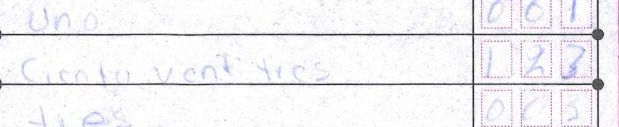

<!-- _class: title -->
<!-- _paginate: false -->

# Two Hands

Verifiable quality control for handwritten numbers.

OCR reads the number. Two Hands checks whether the whole form agrees. Gemma on AMD

<!--
Talk deck for the video (slides/video-script.md). Every number and its source is in the evidence deck, slides/slides.md, and in README.md.
-->

---

6.5%

of polling stations not recounted: the two official records of the same paper disagree.

<!--
Source: results/national_counts.md (INE PREP 2024 CSV; Computos Distritales 2024 CSV). 3,382 of the 52,167 polling stations that were not recounted: the preliminary capture and the certified count disagree on at least one vote field. A difference says two captures disagree, not which one is right; the photo does. Clerical only: no party, no totals, no outcome.
-->

---

19.2%

of national forms fail their own row sum, in the official capture.

<!--
Source: README "Why double keying is not enough"; app/numbers.py; docs/NUMBERS.md (PREP 2024 CSV, docs/sources/tally-witness-pilot.md section 1): 26,336 of 137,196 nationally captured forms.
-->

---

## Two hands and a referee

Hand 1
Gemma reads digits and words

Hand 2
A second reader agrees

Referee
The paper's own arithmetic

<!--
Gemma-4-31B-IT on AMD Token Factory reads every field twice: the handwritten digits and the amount in words. A second, independent reader (Qwen3.8-27B on AMD) must agree field by field; it never overrides Gemma, it only withholds acceptance. The referee: words = digits, rows sum to TOTAL, sections agree. Every identity holds: accepted. Any fails: routed to a person, with the field named and its photo. docs/ARCHITECTURE.md.
-->

---

366 ≠ 466

Gemma read 23. The paper says 123. Routed to a person.

<!--
Form 122655C0100, Option 02 (masked crop, right of the logo column). Gemma read 23 in digits and in words; the rows sum to 366, the form's TOTAL is 466; routed. With the paper's 123 the sum holds: 466 = 466. Source: docs/TRACE.md (b), /trace#routed.
-->

---

1,270

real handwritten tally sheets read by Gemma on AMD.

49 capture errors confirmed by the certified count.

<!--
README "Real data": a pre-registered random 300 and a whole state (Colima); 49 capture errors confirmed by the certified count, each with its photo.
-->

---

91.6%

vs 62.84% for the AI reading the state bought.

Gemma on AMD

Google Document AI

Same metric. Baja California Sur, local actas.

<!--
README "Against the incumbent": on Baja California Sur's 2024 local actas, 91.6% of fields match the published values, on the same per-field metric where the state's purchased Google Document AI reading scored 62.84% (pre-registered random 300 actas). Full line: 91.58% (n = 3,622 fields; Wilson 95% 90.63-92.44%); theirs 14,501 of 23,077 fields on all 2,020 actas, against the manual capture rather than the published values. results/ieebcs/score.json, scripts/ieebcs_score.py --check.
-->

---

27 of 28

certified-detectable capture errors caught (one state, pre-registered).

A person's blind re-read of the AI-judged disputes: 0 read differently.

<!--
README "Checked": recall 27 of 28 on the capture errors the certified count reveals (Colima, PROTOCOL.md Amendment 9); not total recall. results/colima/recall.md.
-->

---

## Why Gemma, on AMD

| | **Gemma-4-31B-IT** | Qwen3.8-27B |
|---|---|---|
| Forms accepted, no person | **55 of 300** | 31 of 300 |
| $ per 1,000 forms | **$0.14** | $0.64 |
| Time per read | **87 s** | 241 s |

<!--
README "Why Gemma" (app/data/bakeoff_300.json): same 300 forms, same gate, on AMD: Gemma accepts 1.8x the forms Qwen3.8-27B does at the same error rate, 4.6x cheaper and 2.8x faster. Whole state: Colima, 982 sheets read on AMD for $0.14 (results/colima/).
-->

---

$1

per sheet audited (proposed). Buyer: INE, 32 state institutes and their outside auditors.

First step: a paid shadow-mode pilot, 2027.

<!--
README "Business at a glance": price from app/pricing.py (a proposal): $1 per sheet audited (proposed); first step: a paid shadow-mode pilot on one state's 2027 count. Why now: 6 June 2027, the federal midterm and 32 concurrent local elections.
-->

---

## Elections are our proof set, not our only market.

Same public data: 7 more countries. Health reporting on DHIS2: 70+ countries.

Not yet measured.

<!--
README "Next: elections" and "Next: health"; sources: docs/BUSINESS.md "Sources for the Business at a glance table".
-->

---

<!-- _class: title -->
<!-- _paginate: false -->

# Two Hands

Verifiable quality control for handwritten numbers.

Gemma-4-31B-IT on AMD Token Factory

<!--
Detail and sources: the evidence deck (slides/slides.md, two-hands-slides.pdf) and README.md. make eval recomputes every number offline.
-->
